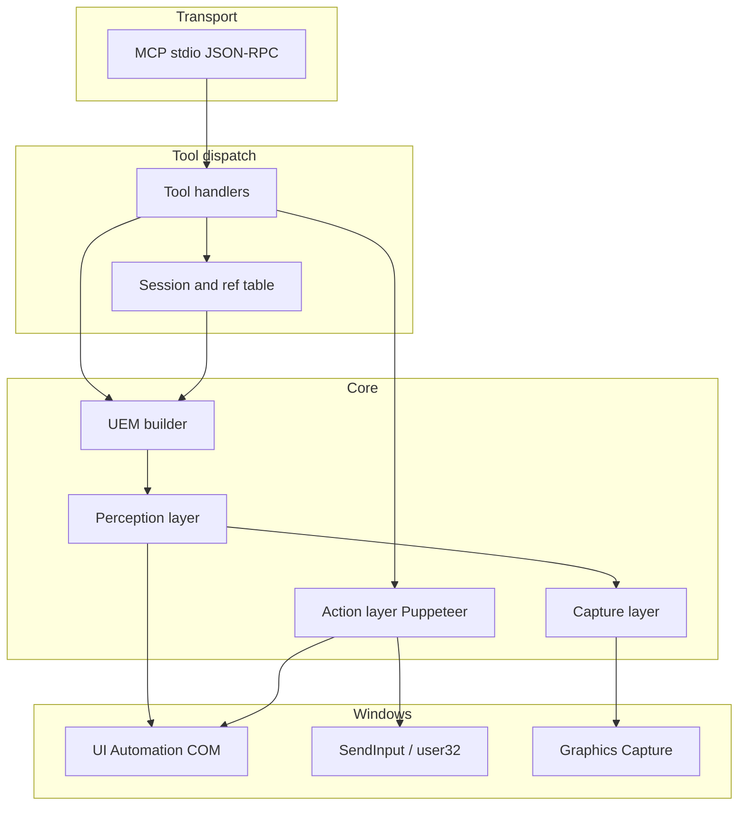
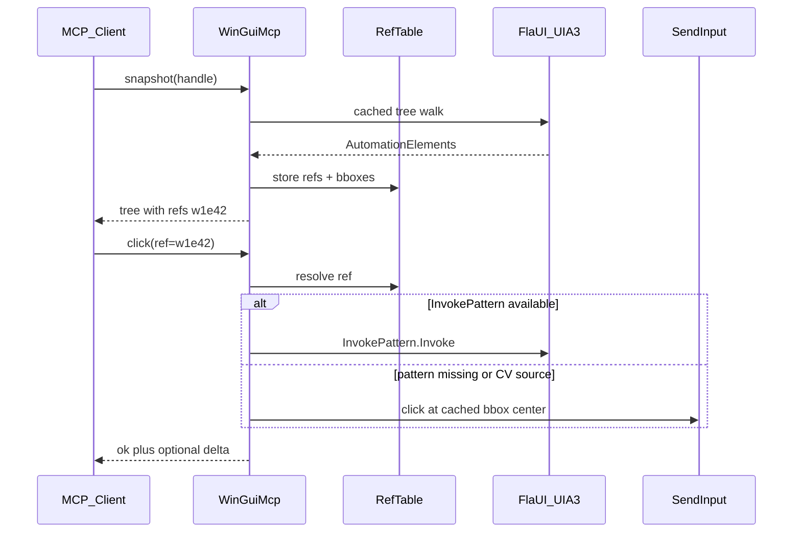

# Architecture

WinGuiMcp is a layered MCP server that exposes Windows desktop automation through a Playwright-style snapshot + ref API. This document describes runtime structure, data flow, and session semantics.

Related: [data-model.md](data-model.md), [tools.md](tools.md), [errors.md](errors.md).

## Goals

- **Accessibility-first** — UIA control patterns for semantic, DPI-independent actions.
- **Token-efficient** — Structured text trees, not screenshots, as the primary perception channel.
- **Deterministic refs** — Agents target `w1e42`, not `(x, y)`.
- **Graceful degradation** — SendInput fallback when patterns are unavailable; CV fallback when UIA is blind (Phase 3).

## Stack

| Layer | Technology |
|-------|------------|
| Language | C# |
| Runtime | .NET 9 |
| Host / DI | `Microsoft.Extensions.Hosting` |
| MCP | `ModelContextProtocol` SDK, stdio JSON-RPC 2.0 |
| UIA | FlaUI 5 (UIA3 primary, UIA2 fallback for legacy WinForms) |
| Input | P/Invoke `SendInput` |
| Capture | WGC (Phase 1), DXGI (Phase 2+) |
| CV | ONNX Runtime + Windows.Media.Ocr / RapidOCR (Phase 3) |

**Language choice, alternatives, NuGet packages:** [stack.md](stack.md).

Prior art: [shanselman/FlaUI-MCP](https://github.com/shanselman/FlaUI-MCP) demonstrates the MCP + FlaUI snapshot pattern.

Research alignment: [research/deep-research-report.md](research/deep-research-report.md) (optional PDF: [open-source-windows-gui-control-for-ai-agents.pdf](research/open-source-windows-gui-control-for-ai-agents.pdf)) recommends a hybrid accessibility-first controller with MCP as the agent transport — WinGuiMcp implements that pattern directly (MCP-first for Phase 1; no separate WebDriver layer). See [stack.md#architectural-decisions-aligned-with-research](stack.md#architectural-decisions-aligned-with-research).

## Control stack (resolution order)

Use the **highest layer that works** for each operation; fall downward only when required. Aligned with Microsoft platform guidance and the landscape survey in the research PDF.

| Priority | Layer | Use for | Never use for |
|----------|-------|---------|---------------|
| 1 | UIA control patterns | Invoke, Value, Toggle, Scroll, ExpandCollapse, Selection | Default keyboard via PostMessage |
| 2 | UIA tree + refs | Snapshot, `find_element`, semantic targeting | Primary navigation via screenshots |
| 3 | MSAA / IAccessible2 bridge | Legacy controls, Firefox-style gaps (Phase 2+) | Replacing UIA when UIA works |
| 4 | Win32 window APIs | `list_windows`, focus, geometry | Widget-level semantic control |
| 5 | SendMessage | Known stable message contracts only (Phase 2+, opt-in) | Generic keyboard simulation |
| 6 | SendInput | Click/type/hotkey fallback, CV-sourced targets | When UIA pattern exists |
| 7 | Capture + ROI OCR / CV | Inaccessible regions, icon-only affordances (Phase 3) | When UIA tree is sufficient |
| — | Driver / virtual HID | — | **Out of scope** for all phases |

**Explicitly out of scope:** `mouse_event`, PostMessage keyboard, `SetWindowsHookEx` injection, virtual HID / kernel drivers.

## Layer diagram



## Proposed module layout

```
src/WinGuiMcp/
  Program.cs                 # Host + MCP server bootstrap
  Transport/                 # MCP tool registration
  Tools/                     # One handler per MCP tool
  Session/
    SnapshotSession.cs       # snapshotId, ref table, invalidation
    RefTable.cs              # ref → element, bbox, patterns
  Perception/
    UiaSnapshotBuilder.cs    # Cached tree walk + pruning
    VisionFusion.cs          # Phase 3: OCR + detector + IoU merge
  Action/
    PatternExecutor.cs       # Invoke, Value, Toggle, …
    InputSimulator.cs        # SendInput wrapper
  Capture/
    WindowCapture.cs         # WGC, BitBlt fallback
  Platform/
    DpiManager.cs            # Per-Monitor-V2 awareness
    WindowEnumerator.cs      # list_windows, focus
  Accessibility/             # Phase 2: MSAA/IA2 bridge adapter
  Observability/             # Phase 2: trajectory logging
  Events/                    # Phase 2: SetWinEventHook + UIA event bus
```

## Core loop



## Session model

Each MCP connection maintains one **SnapshotSession**:

| State | Description |
|-------|-------------|
| `snapshotsByWindow` | Map `windowIndex` → latest `snapshotId` (UUID) |
| `refTable` | Map ref → live element metadata |
| `windowRegistry` | Maps `windowIndex` → HWND |
| `lastActivity` | For idle timeout |

### Invalidation rules

1. **`snapshot(handle)`** — New `snapshotId` for that window's `windowIndex`; all prior refs for that index are stale. Other windows' refs remain valid until their own snapshot or session reset.
2. **Window closed** — Purge refs; subsequent lookups return `WindowGone`.
3. **Idle timeout** — Default 30 min; entire session cleared.
4. **New MCP connection** — Fresh session.

Agents must re-snapshot after UI navigation, dialogs, or `ElementNotFound` with `stale: true`.

## Perception layer

### UIA path (Phase 1+)

1. Attach to HWND via FlaUI.
2. Configure `CacheRequest`: Name, ControlType, AutomationId, ClassName, IsEnabled, IsOffscreen, BoundingRectangle, all interaction patterns.
3. Walk tree with `TreeWalker`; apply pruning ([data-model.md](data-model.md)).
4. Assign refs depth-first; populate RefTable with bboxes (physical pixels).

Performance target: sub-second snapshot for typical dialogs (<500 nodes). Proposed p95 budgets (informational, local desktop): see [phases.md](phases.md#performance-budgets).

### Three-tier perception (Phase 1–3)

ROI-first: narrow candidates with UIA/window metadata before running vision. Full-screen parsing is the last resort.

| Tier | When | Mechanism |
|------|------|-----------|
| 1 — Structure | UIA/MSAA exposes element | No OCR; use snapshot tree only |
| 2 — ROI OCR | Need text in a known region; UIA value missing | Windows.Media.Ocr or RapidOCR on element bbox crop (Phase 3) |
| 3 — Full CV | Sparse/empty UIA tree, canvas, icon-only UI | WGC capture → downscale ~1024px → detector + captioner + OCR |

Tier 2 uses **PaddleOCR-class mobile models or RapidOCR** where ONNX is available; **Tesseract** as lowest-dependency fallback for offline ROI OCR (Phase 3 config).

### CV path (Phase 3)

Triggered when:

- UIA tree empty/sparse for visible window
- Known opaque window class (canvas, some game engines)
- Action failure on UIA element
- Caller sets `useVision: true`

Pipeline: WGC capture → downscale ~1024px → OCR + YOLO-style detector + captioner → UEM nodes → IoU dedup (>10% overlap with UIA → discard CV node).

## Action layer (Puppeteer)

Priority order for ref-based actions:

| Priority | Method | When |
|----------|--------|------|
| 1 | UIA control pattern | Element has Invoke/Value/Toggle/… |
| 2 | SendInput at bbox center | Pattern missing, or `source: cv` |
| 3 | Never | `mouse_event`, `PostMessage` keyboard |

Before SendInput: call `focus_window` on target HWND. Reconcile UIA bbox against DPI ([security.md](security.md) for multi-monitor hazards).

Post-action: optional lightweight tree diff; emit `_warning` if no change ([errors.md](errors.md)). Warning emission is Phase 2; contract is defined in errors.md.

## Capture layer

| Mode | API | Phase |
|------|-----|-------|
| Per-window | Windows.Graphics.Capture | 1 |
| Full screen | WGC or BitBlt | 1 |
| Games / exclusive fullscreen | DXGI Desktop Duplication | 2 |

Screenshots are adjunct to snapshots—not the primary navigation mechanism.

## Cross-cutting concerns

### DPI

Application manifest: `PerMonitorV2` DPI awareness. All RefTable bboxes stored in physical pixels. Validate against capture frame when using SendInput.

### Auto-wait and events (Phase 2)

Poll UIA conditions with backoff for MVP `wait_for`. Phase 2 adds:

- UIA event subscriptions: `StructureChanged`, `PropertyChanged`, `FocusChanged`
- `SetWinEventHook` for window focus/title changes and stale-element detection
- Event-driven `wait_for` before polling fallback

### Observability (Phase 2)

Optional trajectory log: tool name, params (refs only, not bboxes), snapshotId, timing, warnings. For replay/debug—not sent to agent by default.

## Transport

**MVP:** stdio only (Cursor, Claude Desktop).

**Future:** Streamable HTTP/SSE with Bearer auth and IP allowlist ([security.md](security.md)). Not in Phase 1.

## Non-goals (all phases)

- HostAgent / multi-agent orchestration (UFO-style)
- Record-and-replay script export (WinWright-style)
- Remote desktop / cross-machine control
- Linux or macOS support
- Separate WebDriver/JSON-RPC controller service (MCP is the agent interface; no dual API in MVP)
- Kernel / virtual HID / driver-level input injection
- Unrestricted raw desktop tools without policy layer

These may be future projects; they are out of scope for WinGuiMcp Phase 1–4.
