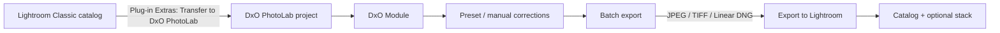
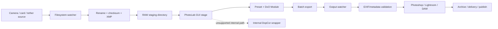
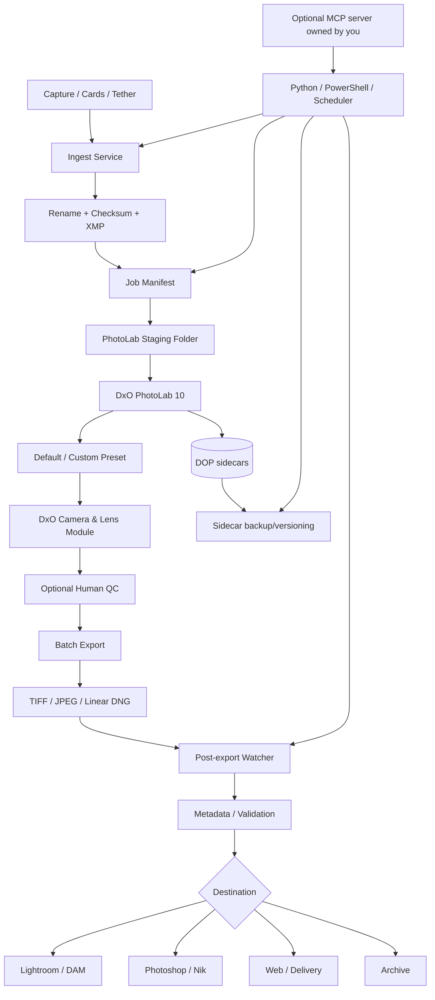

# DxO PhotoLab Plugins, APIs, MCP, and Automation: Technical Research Report

## Executive summary

As of **October 22, 2026**, DxO PhotoLab 10 has a strong batch-processing and application-integration model, but it is **not a developer platform in the usual sense**. DxO documents presets, `.dop` correction sidecars, DxO Camera and Lens Modules, batch export, export to other applications, a dedicated Lightroom Classic round-trip plug-in, and tightly integrated DxO FilmPack/ViewPoint extensions. It also integrates with Nik Collection as an external/rendered-image workflow. However, I found **no public, supported PhotoLab SDK, REST API, local RPC API, COM interface, AppleScript dictionary, general third-party plug-in SDK, command-line batch interface, headless mode, hot-folder service, or MCP server** in DxO's current official PhotoLab documentation or support material. The current PhotoLab 10 guide itself exposes user-facing integration points such as DxO Modules, presets, sidecars, and export, rather than a developer/API section.

The distinction between PhotoLab's different meanings of "plug-in" is important. **DxO FilmPack** is already built into PhotoLab and becomes available when a FilmPack license is activated; it is not dynamically installed through a general plug-in API. **DxO ViewPoint 6** similarly extends PhotoLab by adding palettes/tools inside the PhotoLab editing environment. **Nik Collection 9**, by contrast, is primarily a rendered-image handoff: PhotoLab processes the RAW image and transfers a rendered representation to a Nik application. These are proprietary DxO integrations, not evidence of an extensible third-party PhotoLab plug-in architecture.

The most capable official external integration is **Adobe Lightroom Classic**. PhotoLab installs a Lightroom Classic plug-in that can transfer selected RAW images into a PhotoLab project; PhotoLab can then return JPEG, TIFF, or Linear DNG outputs to Lightroom, optionally stacking them with the originals. This is an integration/workflow interface, not a general PhotoLab programming API.

For large automated workflows, the most defensible architecture today is therefore **automation around PhotoLab rather than automation inside PhotoLab**: automate ingest, rename, metadata, filesystem monitoring, job staging, backup, post-export processing, delivery, and archiving with Python/PowerShell/shell tools; use PhotoLab's presets, automatic DxO Modules, `.dop` sidecars, and batch export for the PhotoLab stage. Where completely unattended processing is mandatory, PhotoLab is currently a poor architectural fit because DxO does not document supported headless processing. Community experiments with the internal `DopCor` processing executable exist, including the open-source `DxO-Batch-Image` project, but these rely on undocumented internals, are version-sensitive, and should not be treated as production APIs.

**MCP is unspecified in the context of DxO PhotoLab.** I found no official DxO terminology defining MCP as either "Module Control Panel" or "Micro Camera Profiles." DxO's official term for its calibration data is **DxO Camera and Lens Module**, often shortened to **DxO Module** or **DxO Optics Module**. A 2026 PhotoLab forum feature request explicitly proposes creating an "MCP server" for connections to AI assistants, strongly indicating **Model Context Protocol** in that discussion—but it is a user feature request, not a released DxO capability. Consequently, "MCP = module control panel" and "MCP = Micro Camera Profiles" should be treated as **unspecified/unverified**, while "MCP = Model Context Protocol" is a plausible modern meaning but is likewise **not an official PhotoLab integration today**.

The practical status is:

| Capability | PhotoLab 10 status | Suitable for production automation? |
|---|---|---|
| Public SDK | **Not publicly documented/found** | No |
| Public REST/HTTP API | **Not publicly documented/found** | No |
| General third-party PhotoLab plug-in SDK | **Not publicly documented/found** | No |
| Official CLI | **Not publicly documented/found** | No |
| Headless rendering | **Not publicly documented/found** | No |
| Native hot/watch folder | **Not publicly documented/found** | No |
| AppleScript scripting dictionary | **Not publicly documented/found**; community reports GUI scripting instead | No |
| COM/.NET automation interface | **Not publicly documented/found** | No |
| MCP server | **Not publicly documented/found**; community feature request exists | No |
| Lightroom Classic round-trip | **Officially supported** | Yes, with interactive PhotoLab stage |
| Export to external application | **Officially supported** | Yes, rendered-file workflow |
| FilmPack integration | **Official, tightly integrated license unlock** | Yes |
| ViewPoint integration | **Official, tightly integrated extension** | Yes |
| Nik Collection integration | **Official rendered-image workflow** | Yes |
| Batch processing/export | **Officially supported** | Yes, GUI-driven |
| Presets | **Officially supported** | Yes |
| `.dop` correction sidecars | **Officially supported** | Yes, as interchange/state files |
| DxO Camera/Lens Modules | **Officially supported, automatically managed** | Yes |
| Undocumented `DopCor` executable | Internal/community-discovered | **No recommendation for production** |

The remainder of this report explains why that architecture matters, what can realistically be automated, and where the legal and operational boundaries lie.

## Official developer and extension surface

The most important finding is that there is currently **no conventional PhotoLab developer portal** comparable to the SDK ecosystems of applications such as Photoshop. Searches of the current PhotoLab 10 User Guide, DxO Support Center, DxO product material, and current documentation did not surface API reference documentation, C/C++ headers, .NET assemblies intended for third-party use, JavaScript/Lua/Python bindings, OAuth/API credentials, a local socket protocol, or a plug-in packaging/registration specification. Community discussions in late 2025 continue explicitly to describe the lack of a PhotoLab SDK, and a long-running command-line request remained a feature request rather than a documented product facility in 2025.

That does **not** mean PhotoLab is isolated. Its supported extension surface is workflow-oriented rather than code-oriented.

| Official mechanism | What it exposes | Direction | RAW/non-destructive implications | Programmability |
|---|---|---|---|---|
| DxO presets | Reusable groups of correction settings; current UI includes preset import/application facilities | Internal | Corrections remain part of PhotoLab's non-destructive workflow | GUI, not documented API |
| Default correction preset | Automatically determines the starting corrections when images are encountered | Internal | Useful for standardized ingest/default processing | Configuration rather than scripting |
| `.dop` sidecars | Per-image correction/settings state; explicit import/export commands | File interchange | Does not render pixels; transfers PhotoLab correction state | File-level orchestration possible, schema not a supported API |
| XMP metadata | Standard metadata sidecars handled separately from PhotoLab correction sidecars | File interchange | Metadata rather than PhotoLab adjustment engine | Can be manipulated by normal metadata tooling; PhotoLab-specific semantics still matter |
| DxO Camera/Lens Modules | Camera/lens-specific calibrated optical and sensor models | Internal/downloaded assets | Applied as part of RAW processing | Managed by PhotoLab, no external module API documented |
| Batch selection + batch export | Same workflow/settings can be processed across sets of images | Internal/output | Full PhotoLab processing | GUI-driven |
| Export to disk | JPEG/TIFF/Linear DNG and associated output settings | Outbound | Produces rendered/partially processed derivatives | GUI-driven |
| Export to application | Renders and opens the result in another application | Outbound | Boundary generally occurs at a rendered file | GUI-driven |
| Lightroom Classic plug-in | Transfers Lightroom selections into PhotoLab | Bidirectional workflow | RAWs enter PhotoLab; processed derivatives return | Official integration but not a public developer API |
| Nik Collection | Sends processed material to Nik tools | Outbound/round-trip | Nik does not form an arbitrary RAW-stage PhotoLab extension | Official integration |
| FilmPack | Unlocks built-in PhotoLab functionality/palette | Internal | Operates inside the PhotoLab RAW workflow | Proprietary fixed extension |
| ViewPoint | Adds geometry functionality/palette | Internal | Operates inside PhotoLab and on supported RAW data | Proprietary fixed extension |

**Presets are the closest thing PhotoLab has to a supported declarative processing interface.** A preset can establish repeatable corrections without a human reconstructing every slider position, and PhotoLab 10's documentation includes preset importing and applying. The application also has a configurable default correction preset, making initial processing deterministic enough for many high-volume workflows even though there is no equivalent of `photolab --preset X *.nef`.

**`.dop` sidecars are the second major automation primitive.** DxO explicitly documents importing and exporting a `.dop` sidecar containing the selected image's settings. This makes sidecars useful for backup, transfer between installations, and external job orchestration. They should **not**, however, be treated as a stable public serialization API: DxO documents the file's purpose, not a schema/version contract intended for third-party writers. A robust automation system should therefore preserve and move PhotoLab-generated `.dop` files rather than generating or mutating their contents itself.

**DxO Modules are not ordinary ICC/DCP profiles or downloadable "plug-ins."** DxO describes a Camera and Lens Module as a mathematical model for a particular camera/lens combination. It contains measured information used to correct characteristics including sharpness, distortion, vignetting, chromatic aberration, sensor noise, and color behavior, with corrections adapting to capture parameters. The same module technology is used by PhotoLab and other DxO applications.

That distinction matters for automation: installing a "lens profile pack" is not analogous to copying an Adobe preset folder. PhotoLab identifies the camera/lens combination and manages the corresponding DxO Module from within the application. I found no documented endpoint for programmatically querying the DxO module catalogue from PhotoLab, forcing installation, supplying a custom module, or invoking the module engine independently of DxO software.

The strongest official application-to-application interface is the **Lightroom Classic workflow**. DxO describes two cooperating pieces: a Lightroom plug-in that transfers RAW images into PhotoLab, and PhotoLab's Export to Lightroom functionality. The Lightroom component is normally installed automatically and can be reinstalled from PhotoLab. This is useful, but architecturally it remains a fixed DxO workflow rather than an SDK that third parties can reuse.

## Plugins, modules, MCP, and the third-party ecosystem

PhotoLab's use of the word **plug-in** needs to be interpreted product by product.

**DxO FilmPack 8** is the most tightly integrated example. DxO's support documentation states that no separate FilmPack plug-in installation is required for PhotoLab: FilmPack is already integrated and becomes available after entering a valid license key. On Windows, activation is reached through **Help → Enter your license key**; on macOS, through the PhotoLab application menu. A dedicated FilmPack palette and associated controls then appear. The current support article notes that FilmPack 8 requires PhotoLab 9 or later.

FilmPack can independently function as a standalone application and as a Lightroom Classic/Photoshop plug-in, including batch workflows in those host applications. That does not imply that PhotoLab itself accepts arbitrary Photoshop-style plug-ins: FilmPack has product-specific integration implemented by DxO.

**DxO ViewPoint 6** follows a similar model in PhotoLab. DxO says that when installed as a PhotoLab extension it appears as an additional palette; PhotoLab then gains additional geometry tools. ViewPoint also has distinct Adobe plug-in/external-editor modes. Version 6 can process RAWs in standalone mode and uses DxO Optics Modules, while inside PhotoLab the common module corrections are already available before the ViewPoint-specific tools are applied.

**Nik Collection 9** differs. DxO's current Nik documentation describes a suite of seven applications/plugins and supports integration with PhotoLab as well as Adobe and Affinity-family workflows. In PhotoLab, Nik is invoked through a dedicated export/selection workflow after the PhotoLab stage. DxO's educational material explicitly distinguishes this from native RAW processing: Nik applications operate on rendered RGB data rather than directly replacing PhotoLab's camera-RAW development engine.

The resulting ecosystem looks like this:

| Product / project | Type | PhotoLab relationship | Automation value | Support/risk |
|---|---|---|---|---|
| **DxO FilmPack 8** | Commercial DxO add-on | Functionality already embedded in PhotoLab; license unlocks it | Presets/renderings become part of normal PhotoLab batch workflow | Official |
| **DxO ViewPoint 6** | Commercial DxO add-on | Adds PhotoLab palette/tools | Geometry corrections remain in normal PhotoLab workflow | Official |
| **Nik Collection 9** | Commercial DxO suite | PhotoLab sends rendered images to Nik applications | Useful downstream stage; can fit batch-oriented pipelines | Official |
| **Adobe Lightroom Classic** | Third-party commercial host | DxO-supplied transfer plug-in + Export to Lightroom | Best-supported orchestration/round-trip route | Officially supported DxO integration |
| **Photoshop** | Third-party commercial host | No general PhotoLab-as-Photoshop-plug-in architecture found; FilmPack/ViewPoint/Nik themselves support Photoshop | Typically use rendered output/application handoff | Supported at individual DxO-product level |
| **Affinity / other image applications** | Third-party application | Can participate through supported external/export workflows where offered | Post-PhotoLab editing | File-level integration rather than PhotoLab API |
| **gerfra/DxO-Batch-Image** | Open-source GitHub project | Wraps undocumented/internal DxO processing components | Experimental pseudo-CLI batch processing | **Unofficial/high risk** |
| **photo-sidecar-cleaner** | Open-source sidecar utility | Recognizes `.dop` in sidecar-oriented file management | Cleanup/pipeline hygiene only | External utility; not PhotoLab control |
| **PreviewCode** | Open-source macOS utility | Can preview text-like files including `.dop` | Inspection/debugging, not processing | External utility |
| **AutoHotkey / controller mappings** | Community automation technique | Drives the GUI through shortcuts/input | Can reduce repetitive interaction | Unofficial/brittle |
| **Loupedeck/TourBox-style controllers** | Third-party hardware/software | Community mappings rely largely on available UI shortcuts; users have requested an open API | Editing ergonomics, not real programmatic control | No PhotoLab controller API documented |

I found **no verified commercial third-party product that loads arbitrary executable code into PhotoLab through a documented PhotoLab third-party plug-in SDK**. That is a meaningful negative result: references to "PhotoLab plug-ins" on DxO's site usually mean **DxO's own FilmPack/ViewPoint integrations**, not a Photoshop-like ecosystem in which independent developers can register modules.

The notable GitHub exception is [gerfra/DxO-Batch-Image](https://github.com/gerfra/DxO-Batch-Image). Its README describes it as using the DxO `DopCor` command-line processing component to process large numbers of images without the normal GUI. The project combines Python and AutoIt, is GPL-3.0 licensed, warns that use is at the user's own risk, and has incomplete macOS support. It is useful evidence that some internal processing machinery can be driven outside the supported UI, but it is **not evidence of an official CLI**.

Community command-line research goes further: users have found internal `DopCor` help/options and experimented with PhotoLab's processing core. Later reports say this remains unofficial and may fail to apply settings consistently or behave differently across versions. That makes it unsuitable as a stable dependency for a commercial production pipeline.

**MCP terminology** can now be resolved as far as public evidence permits:

| Interpretation | Evidence in DxO ecosystem | Assessment |
|---|---|---|
| **Module Control Panel** | No official DxO PhotoLab term found in the current documentation searched | **Unspecified / unverified** |
| **Micro Camera Profiles** | No official DxO term found | **Unspecified / unverified** |
| **Camera/lens module/profile** | DxO officially calls these **DxO Camera and Lens Modules / DxO Modules / DxO Optics Modules** | Valid concept, but acronym **MCP is not established** |
| **Model Context Protocol** | A 2026 PhotoLab forum wish-list post asks DxO to create an MCP server/AI plug-in | Relevant modern interpretation, but **only a feature request** |
| Official PhotoLab MCP server | None found in DxO's public current documentation | **Not publicly documented** |

Consequently, an architecture such as `Claude/Codex → MCP → PhotoLab` cannot presently be built against an official DxO MCP server. A custom MCP server could certainly expose **your own outer orchestration layer**—for example, operations such as "stage files for PhotoLab," "list completed exports," or "open this shoot in PhotoLab"—but it would not magically create a supported PhotoLab processing API underneath it.

## Practical automation workflows

The correct automation strategy depends on whether "automation" means **reducing repetitive work** or **fully unattended rendering**. PhotoLab handles the first well and the second poorly.

**Native batch processing is the strongest supported solution.** PhotoLab is designed to apply corrections to a selected group of images and process a batch in one operation. A workflow can combine a default correction preset, camera/lens-specific DxO Modules, a custom preset or copied settings, and one or more export configurations. Current documentation describes export to disk, external applications, Nik Collection, and Lightroom, with JPEG, TIFF, and Linear DNG among the output choices. ELITE workflows can also support multiple simultaneous output definitions in the export workflow.

That means a high-volume PhotoLab setup can be made quite deterministic:

`input folder → automatic/default corrections → DxO Module → selected preset → batch export preset → output folder`

The missing piece is that the final transition is still controlled through PhotoLab's UI rather than a supported API call.

**Default presets provide useful pseudo-automation.** Instead of repeatedly telling a script to apply the same starting configuration, configure the desired default correction preset in PhotoLab. When images enter the workflow, PhotoLab starts from that standardized state. You can then make only exceptions manually and export the entire selection. The current PhotoLab 10 guide explicitly exposes a "Choosing the default correction preset" configuration stage.

**Lightroom Classic is the most mature orchestrator.** The supported sequence is:

`Lightroom selection → DxO Lightroom plug-in → PhotoLab project → PhotoLab corrections → Export to Lightroom → Lightroom catalogue/stack`

DxO documents the Lightroom command as **File → Plug-in Extras → Transfer to DxO PhotoLab**. PhotoLab is launched and creates a project for the transfer. After editing, **Export to Lightroom** sends JPEG, TIFF, or Linear DNG results back. The returned files can be stacked with originals, and PhotoLab uses its database/sidecar information to retain its own correction state.

This is far preferable to trying to write directly to Lightroom's or PhotoLab's databases.



**Photoshop works best downstream rather than as a PhotoLab host.** I found no current documented mode in which PhotoLab itself loads as a Photoshop filter through an open Photoshop/PhotoLab API. Instead, a typical architecture is PhotoLab RAW development → TIFF → Photoshop, or PhotoLab → Nik → Photoshop. FilmPack, ViewPoint, and Nik independently provide Adobe plug-in modes.

**Sidecars can make a multi-machine workflow safer.** PhotoLab explicitly supports `.dop` import/export. A pipeline can therefore archive RAW + XMP + PhotoLab-generated DOP together and restore that bundle on another licensed workstation. The key recommendation is to treat `.dop` as an **opaque artifact owned by PhotoLab**: move it, back it up, checksum it, and version it, but do not base a critical production system on undocumented field-level edits.

**A built-in hot folder was not found in PhotoLab 10's documented feature set.** The practical replacement is an external watcher. The watcher can detect new RAWs, wait until transfer is complete, rename or checksum them, create a job folder, and launch/open PhotoLab. A separate watcher can monitor the export directory and immediately continue with downstream processing. This externalizes orchestration without relying on internal PhotoLab structures.



**Headless operation is the decisive limitation.** The forum has contained requests for a command-line interface since at least 2020, and 2025 posts still characterize an official CLI/SDK as absent. The internal processing core is not an acceptable substitute for a documented headless contract because its options, configuration dependencies, threading behavior, output semantics, and compatibility can change without notice.

For that reason, recommended automation tiers are:

| Automation tier | Method | Reliability | Recommendation |
|---|---|---:|---|
| Supported batch | Presets + multi-select + export settings | High | **Preferred** |
| Supported ecosystem | Lightroom Classic ↔ PhotoLab | High | **Preferred for DAM workflows** |
| File orchestration | Python/PowerShell/shell around input/output folders | High | **Preferred** |
| `.dop` transport | Preserve PhotoLab-generated sidecars | Medium-high | Good with version testing |
| GUI automation | AppleScript/System Events, AutoHotkey, UI Automation | Medium/low | Use only for controlled desktop environments |
| Internal database writes | Direct SQL modification | Low | Avoid |
| Undocumented `DopCor` | Reverse-engineered/internal processing | Low | Experimental only |
| Fully unattended PhotoLab render farm | No supported mechanism found | N/A | **Not recommended** |

On **macOS**, community reports explicitly note that PhotoLab historically lacks an AppleScript application interface and that integration projects resorted to System Events/GUI scripting. Such automation requires Accessibility permissions and is sensitive to menu names, application versions, localization, focus, and modal dialogs.

On **Windows**, users have successfully used AutoHotkey-style approaches to map repetitive PhotoLab actions and controllers to mouse/keyboard operations, but those scripts are similarly coupled to window geometry and shortcut behavior. PowerShell is excellent for the filesystem and process-orchestration part of the pipeline, while Windows UI Automation/AutoHotkey is a separate, less reliable final mile.

## Step-by-step implementation examples

The examples below deliberately separate **supported PhotoLab operations** from **external orchestration**. There is no fabricated `photolab.exe --preset ... --export ...` command because DxO does not document such a CLI.

**Supported batch export with a preset**

A practical high-volume workflow is:

1. Open the relevant folder/project in PhotoLab.
2. Make sure the needed DxO Camera and Lens Modules are available for the RAWs.
3. Select the images to process.
4. Apply the desired preset/corrections to the selection. PhotoLab's current preset interface includes an **Apply** action, and PhotoLab is designed to process selected batches.
5. Invoke **Export to disk**.
6. Select a previously configured output definition: format, destination, dimensions/quality, naming, color profile, and other desired export properties.
7. Start the export. Use JPEG/TIFF for conventional rendered output, or Linear DNG where your downstream RAW-oriented workflow benefits from it.
8. Let an external watcher take over after the completed files appear in the output directory.

For a repeatable production environment, create separate PhotoLab export configurations such as:

```text
WEB_JPEG
    JPEG
    sRGB
    output: ./export/web/

MASTER_TIFF
    16-bit TIFF
    wide-gamut working/output policy appropriate to pipeline
    output: ./export/master/

LR_DNG
    Linear DNG
    output: Lightroom round-trip
```

The exact output options available should be taken from the current PhotoLab export dialog rather than hard-coded into an external script, because DxO exposes these as application settings rather than an API contract.

**Using DxO Modules in a batch**

You do not need to—or have an official mechanism to—script module files manually.

1. Open/import RAW images.
2. PhotoLab reads camera/lens information and identifies the applicable DxO Camera and Lens Module.
3. Download the proposed module when PhotoLab requests it.
4. If more than one module is plausible, resolve the lens ambiguity in the PhotoLab interface.
5. Allow the module corrections to form part of the normal RAW correction stack.
6. Apply your creative/technical preset on top and batch-export.

DxO's module system is based on measured mathematical models of particular camera/lens combinations, not generic preset files, which is why a module should be managed through the product rather than copied as an unofficial "profile pack."

**Lightroom Classic round-trip**

The supported procedure is particularly useful in studios already using Lightroom as their DAM:

```text
Lightroom Classic
    File
      → Plug-in Extras
        → Transfer to DxO PhotoLab

DxO PhotoLab
    → project created from transferred images
    → apply DxO Module / preset / corrections
    → select processed images
    → Export to Lightroom

Lightroom Classic
    ← JPEG / TIFF / Linear DNG
    ← optional stack with source files
```

DxO documents this transfer plug-in and return workflow directly.

For a pipeline that intends further tonal/color work in Lightroom, Linear DNG is notable because DxO documents it as a way to pass several PhotoLab operations—including optical/geometric processing and denoising—downstream while retaining an appropriate subsequent editing workflow.

**Backing up PhotoLab sidecars with PowerShell**

This does not control PhotoLab; it safely automates the surrounding state management.

```powershell
$Source = "D:\Photos\CurrentShoot"
$Backup = "E:\PhotoLab-Sidecar-Backup\CurrentShoot"

New-Item -ItemType Directory -Force -Path $Backup | Out-Null

Get-ChildItem -Path $Source -Recurse -File |
    Where-Object { $_.Extension -in @(".dop", ".xmp") } |
    ForEach-Object {
        $relative = $_.FullName.Substring($Source.Length).TrimStart('\')
        $target   = Join-Path $Backup $relative

        New-Item -ItemType Directory -Force `
            -Path (Split-Path $target -Parent) | Out-Null

        Copy-Item $_.FullName $target -Force
    }
```

This approach matches PhotoLab's documented division between `.dop` correction sidecars and metadata/XMP data while avoiding assumptions about the internal `.dop` representation.

**Launching/staging PhotoLab from PowerShell**

An external controller can launch PhotoLab, but this must not be confused with an official command-line processing API:

```powershell
# Verify this path on the actual workstation.
$PhotoLab = "C:\Program Files\DxO\DxO PhotoLab 10\DxO.PhotoLab.exe"
$Input    = "D:\Photos\Incoming"

if (-not (Test-Path $PhotoLab)) {
    throw "PhotoLab executable not found: $PhotoLab"
}

if (-not (Test-Path $Input)) {
    throw "Input directory not found: $Input"
}

Start-Process -FilePath $PhotoLab
Start-Process explorer.exe -ArgumentList "`"$Input`""
```

This intentionally launches the application and opens the staging directory separately instead of assuming undocumented PhotoLab command-line parameters. From there, native PhotoLab batch operations remain the processing interface. The absence of a supported processing CLI is confirmed by continuing community requests for one.

A more aggressive version can experiment with passing a file/folder to the executable, but that behavior should be considered OS/application-launch behavior and tested per PhotoLab release, **not a stable DxO API contract**.

**macOS launch orchestration**

The safest AppleScript/shell boundary is likewise to use macOS application launching rather than inventing PhotoLab scripting commands:

```applescript
set rawFile to "/Users/me/Pictures/Incoming/DSC_0001.NEF"
set appName to "DxO PhotoLab 10"

do shell script "/usr/bin/open -a " & quoted form of appName & ¬
    " " & quoted form of rawFile
```

This can form the handoff from an ingest system to the interactive PhotoLab stage. It does not apply presets or start rendering because PhotoLab does not expose a documented AppleScript dictionary for those operations; community attempts have therefore relied on GUI scripting.

Where unattended keystroke automation is unavoidable, the pattern is:

```applescript
tell application "System Events"
    tell process "DxO PhotoLab 10"
        set frontmost to true

        -- GUI automation can be inserted here only after verifying
        -- the current PhotoLab 10 menu names/shortcuts on this machine.
        --
        -- Example:
        -- click menu item "..." of menu "..." of menu bar 1
    end tell
end tell
```

Leaving the actual menu command explicit rather than hard-coding an old PhotoLab shortcut is deliberate: community examples from older PhotoLab releases should not be assumed to match PhotoLab 10, and UI automation is affected by localization and version changes. Historical forum workflows used keyboard-triggered batch export, demonstrating feasibility but not a stable API.

**Python outer-orchestration example**

The following example builds the part PhotoLab itself does not provide: a simple ingest watcher that waits for RAW files, moves them into a job folder, and starts the desktop application. The processing step remains deliberately human/PhotoLab-controlled.

```python
from __future__ import annotations

import shutil
import subprocess
import sys
import time
from pathlib import Path

INBOX = Path.home() / "Pictures" / "DxO-Inbox"
STAGING = Path.home() / "Pictures" / "DxO-Staging"

RAW_EXTENSIONS = {
    ".nef", ".cr2", ".cr3", ".arw", ".orf",
    ".raf", ".rw2", ".dng"
}

POLL_SECONDS = 2.0


def file_is_stable(path: Path, delay: float = 1.0) -> bool:
    """Avoid moving a file that is still being copied."""
    try:
        first = path.stat().st_size
        time.sleep(delay)
        second = path.stat().st_size
        return first == second and second > 0
    except FileNotFoundError:
        return False


def launch_photolab() -> None:
    """Launch PhotoLab only; this is not a processing API."""
    if sys.platform == "darwin":
        subprocess.Popen(
            ["open", "-a", "DxO PhotoLab 10"],
            stdout=subprocess.DEVNULL,
            stderr=subprocess.DEVNULL,
        )
    elif sys.platform == "win32":
        # Adjust after checking the actual installation path.
        exe = Path(
            r"C:\Program Files\DxO\DxO PhotoLab 10\DxO.PhotoLab.exe"
        )
        if not exe.exists():
            raise FileNotFoundError(
                f"Configure the correct PhotoLab path: {exe}"
            )
        subprocess.Popen([str(exe)])
    else:
        raise RuntimeError("DxO PhotoLab is supported on Windows/macOS, "
                           "not this platform.")


def main() -> None:
    INBOX.mkdir(parents=True, exist_ok=True)
    STAGING.mkdir(parents=True, exist_ok=True)

    launched = False

    while True:
        for source in INBOX.iterdir():
            if (
                source.is_file()
                and source.suffix.lower() in RAW_EXTENSIONS
                and file_is_stable(source)
            ):
                destination = STAGING / source.name

                if destination.exists():
                    print(f"Skipping duplicate: {destination}")
                    continue

                shutil.move(str(source), str(destination))
                print(f"Staged: {destination}")

                if not launched:
                    launch_photolab()
                    launched = True

        time.sleep(POLL_SECONDS)


if __name__ == "__main__":
    main()
```

A production implementation would normally add checksums, collision-safe renaming, a manifest/database, retry/error logging, and a second watcher for completed exports. None of those require undocumented PhotoLab access.

**Post-export automation** is where ordinary scripting becomes highly reliable. For example:

```text
PhotoLab export directory
       ↓
filesystem event
       ↓
verify file is complete
       ↓
metadata validation / EXIFTool
       ↓
optional resize or transcoding
       ↓
DAM import / cloud upload
       ↓
checksum
       ↓
archive
```

This boundary is much safer than attempting to automate sliders or internal databases because PhotoLab has already produced normal image files at that point.

## Limitations, licensing, and reverse-engineering constraints

The largest technical limitation is straightforward: **PhotoLab has no publicly documented general-purpose programmatic control plane**. The absence of supported API/CLI contracts means that automation depending on window positions, undocumented executables, internal databases, private IPC, or configuration serialization carries substantial maintenance risk. Community requests for SDKs, controller APIs, CLI processing, and even an MCP server show that these remain desired capabilities rather than established extension points.

The legal constraint is more explicit. DxO's current EULA grants a **single-user, non-exclusive, non-transferable** license and states that, except where permitted by law or the agreement, users must not copy, adapt, reverse engineer, decompile, disassemble, or modify the software. It also prohibits operating the software as a time-sharing, outsourcing, rental, or service-bureau environment or otherwise allowing third parties to use/access it. Critically for module experimentation, the EULA says the software is licensed as a single product regardless of the number of modules and that those modules must not be separated.

This makes several tempting automation strategies especially problematic:

| Technique | Technical issue | Licensing/legal issue | Recommendation |
|---|---|---|---|
| Call undocumented internal executable | Options/behavior may change | Reverse-engineering/use questions depending on method | Experimental research only |
| Extract/repackage DxO Modules | Unsupported internal asset handling | EULA explicitly says modules must not be separated | **Avoid** |
| Patch PhotoLab binaries | Extremely fragile | EULA expressly restricts modification/reverse engineering subject to applicable law | **Avoid** |
| Write to internal PhotoLab DB | Schema can change/corrupt data | Depending on technique, may implicate contractual restrictions | Avoid; use documented UI/sidecars |
| Read/copy PhotoLab-generated `.dop` | Supported sidecar workflow | Ordinary licensed workflow when used normally | Reasonable |
| Build commercial multi-user render service on one license | Technical scaling problems | EULA restricts service-bureau/third-party use | **Do not assume permitted** |
| UI automation of your licensed desktop | Fragile UI coupling | Much less intrusive technically, but still must comply with license | Usually safer technical approach |
| Use official LRC/Nik/FilmPack/ViewPoint integration | Supported | Within licensed product terms | **Preferred** |

PhotoLab activation is also a constraint for render-farm thinking. DxO currently permits PhotoLab **ESSENTIAL on two computers and ELITE on three**, across Windows and/or macOS, but describes the license as personal and states the software must not be run on more than one of those systems at a time. These activations therefore do **not** amount to a multi-node concurrent processing license.

The EULA further states that an internet connection is required to use the software and specifically for activation; operational assumptions for isolated/offline production machines should therefore be checked against the currently licensed version and DxO support policy.

There is an important legal qualification to the EULA's reverse-engineering clause: it itself says **"except as allowed by law."** The scope of statutory exceptions depends on jurisdiction and purpose.

In the United States, **17 U.S.C. §1201(f)** contains a limited interoperability reverse-engineering exception. It covers specified circumstances in which someone who has lawfully obtained the right to use a computer program circumvents a measure for the purpose of identifying and analyzing elements necessary to achieve interoperability of an independently created program, subject to several conditions and to the activity not otherwise constituting infringement. The U.S. Copyright Office describes interoperability as central to that exemption. This is much narrower than a general right to reverse engineer arbitrary software for convenience or automation.

In the European Union, **Directive 2009/24/EC Article 6** provides a conditional decompilation exception where reproduction/translation of code is indispensable to obtain information necessary for interoperability of an independently created program, subject to specified conditions. The Directive further provides that contractual provisions contrary to Article 6 are null and void. That still does not create an unlimited right to extract DxO algorithms, modules, assets, or code, and national implementation and the exact facts matter.

Accordingly, a company contemplating reverse engineering PhotoLab's private IPC, internal rendering engine, or module format for a commercial product should obtain jurisdiction-specific legal advice. The technically safer path is to ask DxO about licensing or an integration partnership rather than treating an internal executable as an implied SDK.

There is also a less dramatic but important **supportability** constraint: even perfectly lawful experimentation can still leave you with an interface for which DxO has made no compatibility commitment. A PhotoLab update can rename an executable, alter a database schema, change an internal serialization format, add an activation dependency, or replace IPC behavior without violating any public API promise—because no such promise exists.

## Recommended architecture and source index

For a serious automation project, I would architect PhotoLab as a **stateful interactive processing node with highly automated ingress and egress**, not as a headless image-processing microservice.



In that design, an optional **custom MCP server** can be useful even though PhotoLab itself has no MCP integration. Your MCP tools might expose operations such as:

```text
list_photo_jobs()
create_photo_job(path)
stage_raw_files(job_id)
launch_photolab(job_id)
list_photo_exports(job_id)
validate_exports(job_id)
archive_job(job_id)
```

The MCP implementation would talk to **your job database, filesystem, metadata tooling, and launch/orchestration scripts**, not to a fictional PhotoLab API. The one operation it should not pretend to support is something like:

```text
photolab.apply_preset(...)
photolab.set_deepprime(...)
photolab.export_headless(...)
```

because no official current endpoint for those operations is documented. The 2026 DxO forum's MCP proposal remains a request, not a shipping interface.

For reliability, I would rank the approaches this way:

**Best architecture:** PhotoLab presets + DxO Modules + native batch export + automated pre/post processing.

**Best DAM architecture:** Lightroom Classic → official PhotoLab plug-in → PhotoLab → Export to Lightroom.

**Best cross-application architecture:** PhotoLab → rendered TIFF/Linear DNG/JPEG → Nik/Photoshop/Affinity/other application.

**Best scripting strategy:** Python/PowerShell/shell for job management, files, metadata, checksums, launching, output monitoring, and archiving.

**Acceptable when necessary:** AppleScript/System Events, Windows UI Automation, AutoHotkey, Stream Deck/TourBox/Loupedeck mappings for repetitive GUI commands, provided the automation is tested after every PhotoLab release. Community experience demonstrates both the feasibility and the brittleness of this approach.

**Not recommended as a production dependency:** reverse-engineered `DopCor`, private PhotoLab databases, manually generated `.dop` internals, extracted DxO Modules, or other undocumented interfaces. The technical compatibility risk is high, and the EULA adds significant constraints concerning reverse engineering and separation of software modules.

The primary sources should be consulted in this order:

| Resource | Why it matters |
|---|---|
| [DxO PhotoLab 10 User Guide](https://userguides.dxo.com/en/photolab) | Current official feature surface: modules, presets, export, menus, configuration. |
| [PhotoLab — Exporting images](https://userguides.dxo.com/photolab/en/exporting-images/) | Export-to-disk/application/Nik/Lightroom behavior and output workflows. |
| [PhotoLab — Menus, Preferences and Functions](https://userguides.dxo.com/photolab/en/menus-preferences-and-functions/) | `.dop` sidecar import/export and application behavior. |
| [DxO Camera and Lens Modules](https://www.dxo.com/en/dxo-module/) | Official explanation of what DxO Modules are and how the calibration system works. |
| [DxO FilmPack support](https://support.dxo.com/) / current FilmPack 8 guide | Confirms FilmPack's unusual "already integrated, license-unlocked" PhotoLab plug-in model. |
| [DxO ViewPoint 6 — Learn & Support](https://www.dxo.com/en/dxo-viewpoint/learn/) | Current PhotoLab extension and Adobe plug-in model. |
| [Nik Collection User Guide](https://userguides.dxo.com/en/nikcollection) | Current Nik Collection 9 host/application workflow. |
| [DxO EULA](https://www.dxo.com/en/eula/) | License, reverse-engineering, module-separation and service-bureau restrictions. |
| [DxO PhotoLab activation policy](https://support.dxo.com/) | ESSENTIAL/ELITE activation counts and personal-use/concurrency restrictions. |
| [EU Directive 2009/24/EC](https://eur-lex.europa.eu/eli/dir/2009/24/oj/eng) | EU software interoperability/decompilation framework. |
| [17 U.S.C. §1201](https://www.copyright.gov/title17/92chap12.html) | U.S. interoperability reverse-engineering exception and anti-circumvention framework. |

The most useful community/developer references are:

| Resource | What it establishes |
|---|---|
| [DxO-Batch-Image on GitHub](https://github.com/gerfra/DxO-Batch-Image) | Concrete example of wrapping PhotoLab's undocumented processing internals; useful as research, not as an official API. |
| [PhotoLab command-line interface forum thread](https://forum.dxo.com/t/dxo-photolab-command-line-interface/13972) | Long-running demand for a supported CLI plus experiments with `DopCor`. |
| [“No PhotoLab SDK? Something can be done”](https://forum.dxo.com/t/no-photolab-sdk-something-can-be-done/53045) | Late-2025 discussion explicitly centered on the absence of a PhotoLab SDK and possible alternatives. |
| [Loupedeck support discussion](https://forum.dxo.com/t/loupedeck-support/9253) | Evidence of demand for an external-controller API and real-world GUI/AppleScript limitations. |
| [PhotoLab 10 wish-list / MCP discussion](https://forum.dxo.com/t/my-wish-list-for-dxo-photolab-10/54594/46) | Community request for an MCP server/AI interface; importantly, a request rather than an existing feature. |

The central architectural conclusion is therefore quite strong: **PhotoLab is highly automatable as a batch-oriented desktop stage, but not presently programmable as a supported rendering engine.** Its real supported "APIs" are human-facing and file/workflow-facing—**presets, `.dop` sidecars, DxO Modules, batch export, Lightroom transfer, external-application handoff, and DxO's own integrated add-ons**. A robust production system should put a conventional automation layer around those boundaries. Until DxO publishes a CLI, SDK, public IPC API, or MCP server, attempts to turn PhotoLab itself into a headless service should be regarded as experimental rather than supported engineering.
