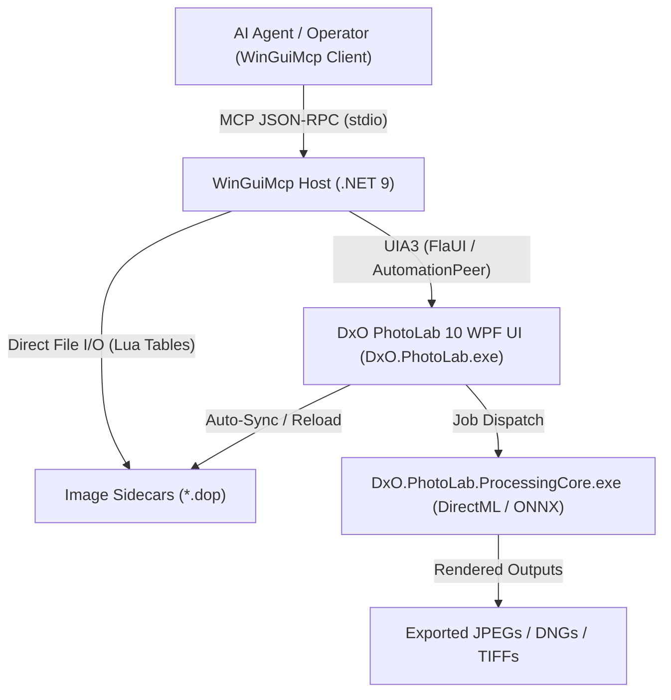

# Specification: DxO PhotoLab 10 UI Control & Automation

## 1. Summary

This specification defines the functional, technical, and architectural requirements for programmatic and agentic control of **DxO PhotoLab 10** on Windows. Automation targets both interactive UI workflows (via WinGuiMcp and Windows UI Automation UIA3) and batch parametric pipelines (via sidecar `.dop` generation and batch export invocation).

---

## 2. Users & Stakeholders

- **Autonomous AI Agents**: Controlling DxO PhotoLab headfully via WinGuiMcp MCP tools (`launch_app`, `focus_window`, `snapshot`, `find_element`, `set_value`, `click`, `hotkey`).
- **Batch Processing Pipelines**: Ingesting folders of RAW images (e.g. `.NEF`, `.CR3`, `.ARW`), applying tailored optical corrections and DeepPRIME noise reduction, and triggering exports.
- **Workflow Automation Integrations**: Macro tools, hot-folder watchers, and photo post-production scripts.

---

## 3. Non-Goals

- **In-Canvas Geometry / Local Brush Painting**: Reverse-engineering the Direct2D/Direct3D raster surface for pixel-perfect manual brush/control-point painting via UIA is out of scope. Local adjustments requiring coordinate drawing should use SendInput fallback or pre-authored presets.
- **Internal Binary Hooking / Undocumented Executables**: We do not invoke or depend on undocumented internal binaries (`DopCor.exe`, reverse-engineered wrappers like `DxO-Batch-Image`) or inject DLLs into `DxO.PhotoLab.exe` or `DxO.PhotoLab.ProcessingCore.exe`.
- **EULA & Licensing Violations**: Automating multi-tenant service-bureau pipelines, separating/extracting DxO Camera and Lens Modules, or bypassing licensing/trial limits is strictly prohibited per DxO EULA terms.
- **Direct Database Manipulation**: Writing directly to PhotoLab's internal SQLite catalog/database (`DxO.PhotoLab.Database.dll`) is out of scope due to data corruption and schema instability risks across point releases.

---

## 4. Architectural Overview

> [!NOTE]
> **MCP Terminology Clarification**: DxO's official terminology for optics calibration is **DxO Camera and Lens Module** (not "MCP"). A community feature request exists for a **Model Context Protocol (MCP)** server, but DxO currently provides no native MCP interface or public REST/CLI API. Therefore, **WinGuiMcp** acts as the external MCP control plane driving the licensed desktop application.

### 4.1 System Components

### 4.2 Presentation & Automation Substrate
- **Binary**: `C:\Program Files\DxO\DxO PhotoLab 10\DxO.PhotoLab.exe`
- **UI Platform**: WPF (.NET) using MVVM bindings (`CommunityToolkit.Mvvm`).
- **Automation Exposure**: WPF controls provide native `AutomationPeer` implementations. Standard accessibility trees expose controls with localized `Name`, `AutomationId`, and UIA Control Patterns:
  - `InvokePattern` for command execution (Export, Reset, Compare, Tab switching).
  - `RangeValuePattern` for numeric adjustment sliders (Exposure, ClearView, Contrast).
  - `ValuePattern` for text entry and stepper boxes.
  - `TogglePattern` for feature activation switches.
  - `SelectionItemPattern` for filmstrip items, preset selectors, and tabs.

### 4.3 Parametric Storage Substrate
- **Format**: Plaintext Lua table definitions.
- **Location**: Adjacent to source media files: `<directory>/<filename>.<ext>.dop`.
- **System Presets**: Stored under `C:\Program Files\DxO\DxO PhotoLab 10\Presets\*.preset`.
- **Behavior**: DxO PhotoLab monitors folder changes. When sidecars are updated externally while the application is active, it refreshes the preview and updates the adjustment controls.

---

## 5. Functional Requirements & Control Surfaces

### 5.1 Application Lifecycle & Workspace Management
- **FR-01 (Launch)**: The system MUST be able to launch `DxO.PhotoLab.exe` and identify the primary top-level window titled `DxO PhotoLab 10`.
- **FR-02 (Workspace Switching)**: The system MUST support deterministic switching between the **PhotoLibrary** browser (`Ctrl + F1`) and the **Customize** editor (`Ctrl + F2`), either via UIA button invocation on the header tabs or shortcut injection.
- **FR-03 (Transient Banner Dismissal)**: The system MUST detect and handle dismissible startup modals, update notices, and trial banners without blocking the workflow.

### 5.2 Filmstrip & Image Selection
- **FR-04 (Thumbnail Navigation)**: The system MUST enumerate items in the bottom filmstrip and select target images using `SelectionItemPattern.Select()`, index offset, or left/right navigation shortcuts.
- **FR-05 (Image Metadata & Flags)**: The system MUST be able to read and set ratings (`0`–`5`) and pick/reject tags (`7` / `9` / `8`).

### 5.3 Palettes & Parameter Adjustments (Customize Workspace)
- **FR-06 (Palette Navigation)**: The system MUST switch between right-hand adjustment sub-palettes (*Light*, *Color*, *Detail*, *Geometry*, *Local Adjustments*) via UIA buttons.
- **FR-07 (Slider Adjustment)**: For standard tools (Exposure, Smart Lighting, Selective Tone, ClearView Plus, Contrast, Vignetting, White Balance):
  - Primary: Set value directly via `RangeValuePattern.SetValue(double)`.
  - Secondary: Set text value via the corresponding stepper input box (`ValuePattern.SetValue(string)`).
  - Fallback: Focus slider and simulate incremental arrow keys (`Left` / `Right`).
- **FR-08 (Tool Toggling)**: Each correction module MUST support state inspection (`TogglePattern.ToggleState`) and toggling via `TogglePattern.Toggle()`.
- **FR-09 (Global Actions)**: The system MUST support triggering `[Reset]` and `[Apply preset]` from the top toolbar.

### 5.4 Export Execution & Monitoring
- **FR-10 (Trigger Export)**: The system MUST trigger image export by invoking the `[Export to disk]` button or dispatching the global accelerator `Ctrl + Alt + P`.
- **FR-11 (Monitor Progress)**: The system MUST verify export initiation and wait for completion by observing either:
  - The UI export progress indicator / overlay.
  - The process lifetime / activity of `DxO.PhotoLab.ProcessingCore.exe`.
  - The creation and byte-write completion of the target file on disk.

---

## 6. Acceptance Criteria

### Scenario 1: Launch and Navigate to Image
- **Given** DxO PhotoLab 10 is installed at the canonical path.
- **When** `launch_app` is executed with the executable path and `focus_window` focuses `DxO PhotoLab 10`.
- **Then** `snapshot` returns an accessibility tree containing the main tabs `PhotoLibrary` and `Customize`.
- **When** `Customize` is selected.
- **Then** the right adjustment inspector and bottom filmstrip become visible.

### Scenario 2: Adjust Image Exposure and Contrast
- **Given** an active RAW image is selected in `Customize` mode.
- **When** the `Exposure` correction tool is targeted.
- **Then** the slider or text box value is updated to `+0.75` EV.
- **When** `DxO ClearView Plus` intensity is set to `50`.
- **Then** the value pattern reflects `50` and the viewport reflects the updated parameters.

### Scenario 3: Batch Export Verification
- **Given** one or more images are selected in the filmstrip.
- **When** `[Export to disk]` is invoked (or `Ctrl + Alt + P` sent).
- **Then** `DxO.PhotoLab.ProcessingCore.exe` spawns or commences rendering.
- **And** within the configured timeout, the target export file exists on disk with a valid non-zero size.

---

## 7. Error Handling & Safety

Mapping to standard WinGuiMcp error codes ([`docs/errors.md`](../errors.md)):

| Condition | Error Code | Recovery Hint |
| :--- | :--- | :--- |
| DxO PhotoLab window not found after launch | `WindowNotFound` | Wait up to 10s for splash screen to complete; check process list. |
| Palette is collapsed or tab is not active | `ElementNotFound` | Select parent sub-palette icon (e.g. Light icon) or expand accordion. |
| UI is blocked by an unexpected modal dialog | `ActionFailed` | Query top-level windows for modal dialogs and dismiss via `Escape` or `OK`. |
| Export process crashes or stalls | `Timeout` / `TargetProcessExited` | Inspect `ProcessingCore.exe` event logs; verify output directory write permissions. |
| Elevated app boundary conflict | `UIPIBlocked` | Run automation host at matching user integrity level. |
