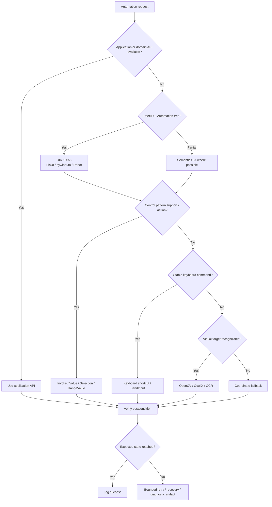
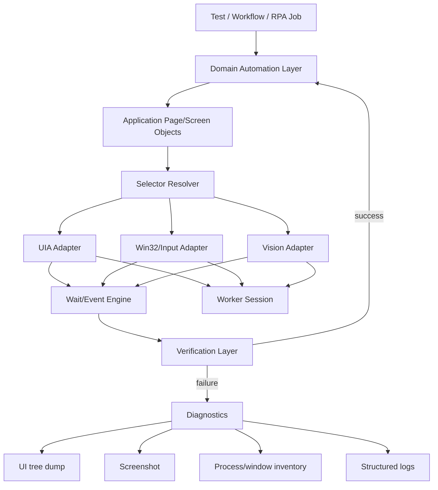

> **Superseded for implementation.** Background research only (October 2026 landscape update). Normative specs: [../SPEC.md](../SPEC.md), [../stack.md](../stack.md), [../tools.md](../tools.md), [../architecture.md](../architecture.md).

# Windows GUI Automation on Windows: APIs, Frameworks, Reliability, Security, and Production Architecture

## Executive summary

Windows GUI automation is best understood as a **stack of progressively weaker interaction mechanisms**, not as a single technology. At the strongest layer, Microsoft UI Automation (UIA) exposes application controls as semantic elements with properties, control patterns, and events. Below that, Win32 input APIs such as `SendInput` emulate keyboard and mouse input. When an application exposes little or no useful accessibility structure, automation falls back to image recognition, OCR, or coordinates. Microsoft itself now follows essentially this layered model in its 2026 `winapp ui` tooling: most operations use UIA patterns, while mouse, touch, pen, and keyboard synthesis are used where semantic UIA operations are insufficient. citeturn13search6turn14search1turn14search19

For a **new production-grade Windows automation system in 2026**, the default technical choices should be:

| Situation | Preferred approach |
|---|---|
| .NET/C# desktop automation | **Microsoft UIA / FlaUI UIA3** |
| Python desktop automation | **pywinauto with the UIA backend**, optionally Win32 backend for old controls |
| Quick workstation macros | **AutoHotkey v2** |
| Deployment/admin scripting with light GUI work | **PowerShell + `System.Windows.Automation`**, or a carefully selected UIA wrapper |
| Keyword-driven testing/RPA | **Robot Framework + a maintained UIA library**, such as RPA Framework Windows or RobotFramework-FlaUI |
| WebDriver-standard desktop testing | **Appium Windows Driver**, with important caveats about its backend; do not start a new project on raw WinAppDriver |
| Visually rendered/custom UI | **OculiX/OpenCV-style visual automation**, only as a fallback |
| Legacy WinForms/WPF Selenium bridge | **Do not start with Winium**; it is effectively historical |
| Electron application | Prefer **UIA for the native application shell**; use browser tooling for internal web content only where the application exposes an appropriate debugging/WebView surface |
| General browser automation | **Selenium/Playwright**, not desktop GUI automation |

Microsoft now explicitly says that **WinAppDriver is no longer under active development** and recommends Appium with the Windows Application Driver plugin for Windows desktop UI testing. There is an important architectural wrinkle: the current Appium Windows Driver project itself says that it proxies Microsoft's old WinAppDriver server and warns that the server has not been maintained for years. Thus, the current WebDriver story is useful when protocol compatibility matters, but direct UIA remains the lower-risk foundation for a greenfield desktop automation framework. citeturn14search0turn16search5

Selenium itself is **not a general desktop automation engine**. Its official scope is browser automation; “Selenium for desktop” means either talking to a desktop WebDriver bridge such as WinAppDriver/Winium or automating web content inside an application when that content can be addressed as a browser/WebView target. citeturn12search0turn12search8

The central reliability rule is:

> **Use application/domain APIs first; UI Automation second; stable keyboard commands third; synthetic pointer input fourth; computer vision fifth; absolute coordinates last.**

This ordering minimizes dependence on focus, screen coordinates, DPI, rendering, themes, animation, latency, and human-readable labels. UIA also offers event subscriptions and property/pattern caching, which enable synchronization without hard-coded sleeps and reduce expensive cross-process calls. citeturn13search1turn13search2turn13search12

Security is not incidental. Windows deliberately restricts cross-integrity UI interaction. `SendInput` is subject to **User Interface Privilege Isolation (UIPI)** and can inject input only into processes at an equal or lower integrity level; Windows does not directly tell `SendInput` callers that UIPI caused an injection failure. UIA access to protected/elevated interfaces is likewise constrained. An automation application that legitimately needs UIAccess has to follow Microsoft's signing and secure-installation rules; Windows performs a PKI signature check on applications requesting UIAccess, and policy normally restricts them to trusted locations such as `Program Files` or Windows directories. citeturn0search0turn1search7turn12search15turn12search18

There is also no general-purpose “headless desktop” equivalent to headless Chromium. System-level clicks and keyboard injection require an interactive desktop; Microsoft's contemporary tooling explicitly documents that injection verbs need an unlocked interactive desktop and fail on a locked or secure desktop. In unattended CI, the scalable pattern is therefore **one interactive automation session per VM/user-session worker**, rather than several focus-dependent automations competing inside one desktop. citeturn14search14

As of October 2026, ordinary Windows 10 editions are already past their October 14, 2025 end of support; new deployments should normally standardize on a supported Windows 11 or supported Windows Server/LTSC configuration unless the organization deliberately maintains an ESU/LTSC exception. The underlying APIs themselves reach much further back—`SendInput` to Windows 2000, core UIA COM interfaces to older Windows generations—but API availability is not the same as a sensible production support policy. citeturn11search0turn11search1turn0search0

Three constraints were not specified in the request and materially affect the final architecture: the **target Windows version/build**, the **preferred implementation language**, and the organization's **security/endpoint-control policy**. The recommendations below therefore distinguish portable architectural advice from language- and policy-specific choices.

The attached Lightroom-specific research provides a useful concrete example of the same layered conclusion—semantic UI automation before input simulation and vision—but the present report generalizes that architecture to arbitrary Windows software rather than Adobe applications. fileciteturn0file0



## Platform and official Windows automation stack

### Win32 input injection

The fundamental Windows API for synthetic keyboard and mouse input is [`SendInput`](https://learn.microsoft.com/en-us/windows/win32/api/winuser/nf-winuser-sendinput). It inserts one or more `INPUT` records into the system input stream, and the events from a single call are inserted serially rather than being interspersed with unrelated injected events. Microsoft documents support from Windows 2000 onward. citeturn0search0

`SendInput` is fundamentally **device/input automation**, not control automation. It can generate:

- keyboard key-down/key-up events;
- Unicode/text-oriented keyboard input;
- mouse movement;
- mouse-button operations;
- wheel input.

It does **not** inherently know that a point is a “Save” button or that a control currently contains a particular value. Correctness therefore depends on the intended target window having focus, its UI being in the expected state, and coordinates/keyboard routing being correct. citeturn0search0

A particularly important security property is UIPI. Microsoft states that applications can inject input only into applications running at the same or lower integrity level, and `SendInput` itself does not expose a specific error code identifying UIPI as the reason for a failure. That is why scripts that work against ordinary applications can mysteriously stop working when the target is started “as Administrator.” citeturn0search0

`SetForegroundWindow` and related focus functions are also deliberately constrained: Windows limits when a process can steal foreground focus. Robust automation should therefore **verify foreground state rather than assume that an activation call succeeded**. Input-first designs that perform `activate → sleep → type` without re-validating the target are a common source of dangerous misdirected keystrokes. citeturn0search0

At the other end of the spectrum, `SendMessage`/`PostMessage` can interact with ordinary HWND-based controls without reproducing every physical input event, but this only works when the target control actually implements the relevant Win32 message semantics. Modern WPF, WinUI, Chromium/Electron, GPU-rendered, and custom controls cannot generally be treated as traditional edit/button HWNDs.

### Microsoft Active Accessibility and `IAccessible`

Microsoft Active Accessibility, usually abbreviated **MSAA**, is the older Windows accessibility model. The principal semantic object is the COM [`IAccessible`](https://learn.microsoft.com/en-us/windows/win32/winauto/how-active-accessibility-works) interface. Clients can obtain accessible objects from HWNDs, screen coordinates, WinEvents, or navigation from existing accessible objects. citeturn13search5

MSAA is still important because a great deal of legacy Windows software exposes accessibility information through it, and Windows has bridges between MSAA and modern UIA. However, Microsoft describes several structural limitations:

- MSAA has one fixed COM interface with a relatively small property set.
- Its model is role-based and difficult to extend for modern controls.
- Navigation can be inconsistent because children may be exposed through different mechanisms.
- It lacks UIA's richer control-pattern model.
- Out-of-process MSAA clients tend to perform worse than equivalent UIA designs. citeturn13search0

For new automation frameworks, MSAA should generally be a **compatibility layer for old applications**, not the primary abstraction. Microsoft recommends UI Automation for new applications and controls. citeturn13search0turn13search9

### Microsoft UI Automation

[Microsoft UI Automation](https://learn.microsoft.com/en-us/windows/win32/winauto/windows-automation-api-overview) is the central semantic automation/accessibility architecture on contemporary Windows. Rather than representing interaction as coordinates and keystrokes, UIA represents the desktop as a hierarchy of automation elements. Elements expose properties such as names, IDs, control types, states, geometry, and framework identifiers; behavior is exposed through **control patterns**. citeturn13search4turn13search6

Typical patterns include conceptual operations such as:

| Pattern | Typical semantic operation |
|---|---|
| `Invoke` | Activate a button/menu command |
| `Value` | Read or set a text/value field |
| `RangeValue` | Read/set a slider or numeric range |
| `Selection` / `SelectionItem` | Work with lists, tabs, radio groups |
| `Toggle` | Check/uncheck/toggle |
| `ExpandCollapse` | Expand trees, combos, menus |
| `Scroll` / `ScrollItem` | Scroll containers or reveal an item |
| `Grid` / `Table` | Structured tabular navigation |
| `Text` | Rich document/text access |
| `Window` | Window state and window-specific functionality |

An important design advantage is that patterns describe **capability rather than appearance**. A button can be invoked regardless of where it was drawn; a slider exposing `RangeValue` can be set to `70` rather than dragged to a guessed x-coordinate. citeturn13search6turn13search8

UIA's major components include several names that are easily confused:

| Name | Meaning |
|---|---|
| `UIAutomationCore.dll` | Core Windows UIA infrastructure and native implementation |
| `UIAutomationClient` | Managed .NET Framework client assembly/API surface |
| `UIAutomationTypes` | Shared managed UIA types |
| `UIAutomationProvider` | Managed provider-side types |
| `IUIAutomation*` | Native COM client interfaces |
| `IUIAutomation2`, `IUIAutomation3`, etc. | Successive generations of the native COM interface |
| “UIA3” in FlaUI | FlaUI terminology for its modern COM-based UIA backend; related to, but not simply synonymous with, one single `IUIAutomation3` interface |

The distinction in the final row is worth emphasizing. **“UIA3” is overloaded terminology.** Microsoft defines a native COM `IUIAutomation3` interface, while FlaUI uses the label `UIA3` for its modern COM-based Microsoft UI Automation implementation. FlaUI contrasts that with `UIA2`, its older managed UIA path. citeturn10search0turn19search5

The native interface generations also have different historical baselines. Microsoft's documentation places `IUIAutomation2` at Windows 8/Server 2012 and `IUIAutomation3` at Windows 8.1/Server 2012 R2; core UIA element interfaces have substantially older baselines. citeturn10search0turn10search9turn10search10

For .NET applications, the classic managed API lives under `System.Windows.Automation` and is supplied by `UIAutomationClient`/related assemblies. It remains usable, although Microsoft directs developers to the Windows Automation API documentation for the latest platform-level information. citeturn0search10turn13search8

### Events, synchronization, and caching

UIA is not limited to querying the screen tree. A client can subscribe to:

- focus events;
- property changes;
- tree-structure changes;
- general automation events;
- notification events;
- text-edit changes in relevant interface generations. citeturn13search1turn13search15

This is critical for reliable synchronization. Microsoft specifically notes that event subscription can improve performance by eliminating continual polling. Providers are not guaranteed to raise every theoretically possible event, however, so robust systems generally use **event-driven waits with a polling/timeout fallback** rather than assuming events are perfect. citeturn13search1

Cross-process property reads also cost more than local memory access. UIA therefore supports cache requests so that sets of properties and patterns can be retrieved together. Microsoft documents caching of properties, patterns, subtree scope, and even cache-only element references for higher efficiency. A framework traversing thousands of elements should use caching rather than repeatedly fetching every property one at a time. citeturn13search2turn13search3turn13search12

### DPI and coordinate systems

UIA does not magically eliminate all coordinate problems. Microsoft documents that relevant UIA coordinate APIs use **physical screen coordinates**. If an automation process is not DPI-aware on a scaled display, logical/physical coordinate translation can yield incorrect element or cursor positions. The recommended design is to make the automation client DPI-aware and consistently operate in physical coordinates when coordinates are necessary. citeturn1search1turn1search5

The same class of issue affects legacy MSAA coordinate APIs. citeturn1search13

This becomes especially important with:

- 125%, 150%, 175%, or custom display scaling;
- multiple monitors with different DPI;
- moving a target window between monitors;
- RDP sessions that reconnect at another resolution;
- image-template matching produced on another workstation.

### Supported Windows versions

There are two different questions: **“How far back does the API run?”** and **“What Windows versions should a 2026 production system support?”**

| Technology | Historical/API baseline | Sensible 2026 position |
|---|---|---|
| Win32 `SendInput` | Windows 2000+ | Use on supported Windows; API age is not a lifecycle guarantee. citeturn0search0 |
| MSAA/`IAccessible` | Legacy Windows accessibility technology | Use only for legacy compatibility. citeturn13search0turn13search9 |
| Core UI Automation | Available on older supported/platform-update Windows generations | Primary semantic Windows automation layer. citeturn10search10 |
| `IUIAutomation2` | Windows 8 / Server 2012+ | Legacy generation of current UIA family. citeturn10search9 |
| `IUIAutomation3` | Windows 8.1 / Server 2012 R2+ | Modern native COM capability generation, though later interfaces also exist. citeturn10search0turn10search12 |
| AutoHotkey v2 | Project says Windows 7+; releases tested primarily on Windows 11 | Suitable for current Windows, but validate target builds. citeturn15search16 |
| AutoIt 3.3.18 | Official matrix: Windows 7/8/10/11 and Server 2008–2022 | Current release remains broad but Windows 7 is its minimum. citeturn16search0turn16search3 |

For greenfield enterprise deployment, supportability should normally be pegged to **Microsoft-supported OS versions**, not merely the oldest release on which an API still happens to load. Ordinary Windows 10 support ended October 14, 2025; exceptions such as LTSC/ESU need to be handled explicitly in the support matrix. citeturn11search0turn11search1

## Tool landscape and capability comparison

### AutoHotkey

[AutoHotkey](https://github.com/AutoHotkey/AutoHotkey) is an automation-oriented Windows scripting language particularly strong for hotkeys, keyboard remapping, quick macros, window activation, input simulation, and lightweight personal automation. Its official repository remains active in 2026 and is GPL-2.0 licensed; the project had updates in September 2026. citeturn15search1turn15search11

Its strengths are development speed and excellent ergonomics for input-centric workflows. Its weakness is that large automation systems easily devolve into stateful sequences of window activation, keystrokes, and coordinates unless the developer deliberately layers semantic discovery and validation around them.

Use it when:

- the application has strong shortcut coverage;
- a human workstation macro is sufficient;
- deployment must be tiny;
- behavior is mostly `window → shortcut → wait → shortcut`;
- a full test-framework abstraction would be excessive.

Avoid making it the primary framework for hundreds of semantically rich controls unless the engineering team is prepared to build its own selector/state/recovery abstractions.

### AutoIt

[AutoIt](https://www.autoitscript.com/site/AutoIt/) is a BASIC-like Windows automation language with built-in keyboard/mouse simulation, window/process manipulation, ordinary Windows-control interaction, COM, DLL calling, and executable compilation. The current stable release found in Adobe—rather, AutoIt's official documentation—is 3.3.18.0, released September 7, 2025; that release raised the minimum OS to Windows 7/Server 2008. citeturn16search0turn16search1turn16search3

AutoIt also includes **AutoIt Window Info (`Au3Info`)**, an important discovery tool for traditional HWND/control-based automation, and AutoItX exposes AutoIt capabilities through a DLL/COM interface, including use from PowerShell or other languages. citeturn16search6turn16search0

Its license is not a conventional open-source license: AutoIt is freeware under its own EULA. The license allows unlimited installation/use and commercial use, including sale/distribution of scripts or compiled scripts, but imposes its own conditions and prohibits reverse engineering of the software product. citeturn18view0

AutoIt's own site warns that scripting-language characteristics can lead to **false-positive antivirus/SmartScreen detections**. That does not mean AutoIt is inherently malicious or that every EDR product flags it, but it is a concrete reason to test corporate endpoint-control policies before selecting compiled AutoIt as a deployment format. citeturn16search4

### PowerShell and UI Automation

PowerShell is excellent orchestration glue but does not have one modern, universally adopted Microsoft-provided “desktop UI automation cmdlet suite.” The most durable approach is often direct access to the .NET `System.Windows.Automation` classes supplied by Microsoft's UI Automation assemblies, with community modules added only if they materially improve developer productivity. citeturn0search10turn13search8

The PowerShell module ecosystem is fragmented compared with FlaUI or pywinauto. This matters because a corporate automation platform should avoid an obscure wrapper becoming its hardest-to-maintain dependency. PowerShell is nevertheless a strong choice for:

- deployment/install workflows that occasionally need UI interaction;
- administration scripts;
- systems already standardized on PowerShell;
- calling COM/.NET/Win32 alongside automation logic.

For a large desktop automation test framework, C#/FlaUI or Python/pywinauto usually provides a cleaner programming model.

### pywinauto

[pywinauto](https://github.com/pywinauto/pywinauto) is the most established Python-native general Windows GUI automation library. It supports two major Windows backends:

- `win32` for traditional Win32/HWND controls;
- `uia` for Microsoft UI Automation. citeturn19search1

This makes it particularly useful for mixed estates: old MFC/Win32 applications can sometimes be handled more directly through the Win32 backend, while WPF, modern WinForms, Store-style applications, and other accessibility-aware software can use UIA.

The project is BSD-3-Clause licensed for modern releases and remains actively developed. Its repository was updated October 15, 2026; a `1.0.0b1` prerelease on that date moved Windows' default backend to UIA and introduced substantial backend/refactoring work. citeturn19search0turn19search3

pywinauto has explicit wait primitives and can dump control identifiers, which makes it much more suitable than raw input scripting for stateful automation. citeturn19search1

### FlaUI

Although the user did not explicitly list it, [FlaUI](https://github.com/FlaUI/FlaUI) deserves inclusion because it is one of the strongest .NET abstractions over Microsoft UI Automation. It supports Win32, WinForms, WPF, Store applications, and exposes both UIA2 and UIA3 backends. Its repository is MIT-licensed and had active changes in 2026. citeturn19search2turn19search5

For a C# greenfield project, it is arguably the default open-source choice unless direct COM control is specifically required.

FlaUI's terminology is useful:

- **UIA2**: older managed Microsoft UIA API path;
- **UIA3**: modern COM UIA path.

The project notes that backend behavior can vary by UI framework—for example, UIA3 tends to be better for WPF/Store-style applications, while some WinForms cases historically behaved differently. That is another reason to make backend selection a configuration option in a generalized framework. citeturn19search5

### WinAppDriver, Appium Windows Driver, and Selenium

[WinAppDriver](https://github.com/microsoft/WinAppDriver) was Microsoft's Selenium/WebDriver-compatible Windows application automation server. Its repository contains tests, a recorder, Selenium Grid guidance, remote-machine guidance, and examples for Win32/WPF/UWP-era applications. It is MIT-licensed. citeturn16search5

But Microsoft's current Windows App SDK guidance says directly that WinAppDriver is **no longer under active development**. The recommended successor is **Appium with the Windows Application Driver plugin**. citeturn14search0

That does not mean “WebDriver Windows automation has vanished.” Instead, it means the architecture has shifted toward Appium. Appium gives organizations familiar W3C/WebDriver client libraries in C#, Python, Java, and JavaScript and a server-oriented integration model. citeturn14search4

However, this transition currently has an important caveat: the Appium Windows Driver repository describes itself as a proxy to Microsoft's WinAppDriver server and warns about that server's maintenance state. Consequently, there is a difference between:

1. **Microsoft's strategic recommendation**: use Appium Windows Driver rather than authoring new raw WinAppDriver tests; and
2. **backend lifecycle risk**: parts of that stack still inherit the old server's limitations.

For new automation infrastructure where WebDriver compatibility is not a requirement, direct UIA/FlaUI is therefore simpler.

[Selenium](https://www.selenium.dev/documentation/) itself remains explicitly a **browser automation project**. Selenium WebDriver's native abstractions are browsers and DOM `WebElement`s, not arbitrary Windows control trees. Selenium Grid scales browser sessions across machines. citeturn12search0turn12search11

Thus “Selenium for Windows desktop” only makes sense through a bridge such as WinAppDriver/Winium/Appium or when controlling actual web content. It should not be listed alongside UIA as an independent Windows desktop accessibility engine.

### Robot Framework

[Robot Framework](https://robotframework.org/) is a higher-level keyword-driven automation/test framework, not itself a Windows accessibility engine. It delegates interaction to libraries. The project supports both test automation and RPA, is backed by the Robot Framework Foundation, and is Apache-2.0 licensed. citeturn15search19turn15search5

Robot's own desktop guidance emphasizes choosing a library appropriate to the application's technology and warns that GUI automation can be slow, unstable, and maintenance-heavy; semantic/native interfaces should be preferred over image/text approaches where possible.

Strong Windows-side choices include:

- `RPA.Windows`/related packages from Robocorp's RPA Framework;
- RobotFramework-FlaUI;
- visual libraries when no accessibility model exists.

Robocorp's RPA Framework remains actively developed in 2026, with a dedicated Windows package and both Robot Framework and Python support. citeturn20search3turn20search11

### SikuliX and OculiX

Traditional **SikuliX** represents the image-based branch of desktop automation: identify controls from screenshots using computer vision and then drive mouse/keyboard input. It is fundamentally independent of source code, DOMs, and accessibility APIs. citeturn20search1

There is an important 2026 lifecycle change. The original SikuliX1 upstream was archived in March 2026, while active development moved to the **OculiX** fork. The active project uses modern OpenCV, Java 17+, OCR options, and VNC/remote capabilities. Both lineage and current project materials identify an MIT-licensed base. citeturn20search1turn20search6

Accordingly:

> For legacy projects, “SikuliX” remains a recognizable technology name. For a **new October 2026 project**, evaluate OculiX rather than assuming the original SikuliX repository is still the active upstream.

Image automation is indispensable for canvas-like interfaces, games, remote applications, custom GPU widgets, Citrix-style surfaces, and software with poor accessibility exposure. But it remains more sensitive than semantic automation to scale, theme, font rendering, anti-aliasing, window geometry, localization, and application redesign.

### Winium

[Winium.Desktop](https://github.com/2gis/Winium.Desktop) implemented Selenium Remote WebDriver for WinForms and WPF. It is MPL-2.0 licensed and historically useful, but its latest listed release is **v1.6.0 from September 2016**. citeturn16search2turn16search15

That makes the recommendation straightforward:

> **Treat Winium as legacy technology for maintaining existing suites, not as a greenfield choice.**

Migration targets are direct UIA/FlaUI, pywinauto, or an Appium-based stack where WebDriver compatibility is mandatory.

### Capability and lifecycle comparison

“Activity” below describes the state visible from official/project sources in October 2026, not a guarantee of future maintenance.

| Tool/API | Semantic controls | Input injection | Image-based | UIA/accessibility tree | Events / waits | Good CI fit | Project position in 2026 | License/status |
|---|---:|---:|---:|---:|---:|---:|---|---|
| **Win32 `SendInput`** | No | **Yes** | No | No | Manual | Medium | Core Windows API | Windows API. citeturn0search0 |
| **MSAA / `IAccessible`** | Yes, limited | No | No | Legacy accessibility tree | WinEvents | Medium | Compatibility layer | Windows API. citeturn13search0turn13search5 |
| **Microsoft UIA / UIA3** | **Excellent** when provider is good | Usually pattern-based, not necessarily physical | No | **Yes** | **Strong** | High with interactive worker | Core recommended semantic layer | Windows API. citeturn13search1turn13search6 |
| **FlaUI** | **Excellent** | Yes/fallback APIs | Screenshot support, not primary vision engine | **Yes, UIA2/UIA3** | Strong | High | Active | MIT. citeturn19search2turn19search5 |
| **AutoHotkey v2** | Limited/native-window oriented | **Excellent** | Basic visual mechanisms possible | Not its central abstraction | Scripted waits | Medium | Active | GPL-2.0. citeturn15search1turn15search11 |
| **AutoIt** | Good for traditional controls | **Excellent** | Pixel/image helpers possible | Not primarily UIA-centric | Scripted waits | Medium | Maintained, slower cadence | Custom freeware EULA. citeturn16search0turn18view0 |
| **PowerShell + UIA** | **Good** | Through Win32/.NET | Via external libraries | **Yes** | Good if engineered | High | Platform stable; wrappers vary | PowerShell/UIA licensing depends on components |
| **pywinauto** | **Very good** | Yes | Screenshots; CV external | **Yes**, plus Win32 backend | **Good** | High | Active, 1.0 beta work in 2026 | BSD-3-Clause. citeturn19search1turn19search3 |
| **Robot Framework + UIA library** | Depends on library | Depends on library | Yes with visual libraries | Yes with UIA/FlaUI/RPA Windows | **Strong orchestration** | High | Active ecosystem | Core Apache-2.0. citeturn15search19turn20search3 |
| **WinAppDriver** | Good where UIA tree exists | Through protocol/backend | Limited | UIA-backed | WebDriver waits | Medium-high | **Legacy/not actively developed** | MIT. citeturn14search0turn16search5 |
| **Appium Windows Driver** | Good where backend exposes UIA | Yes | Limited | UIA-backed | WebDriver waits | High | Active client/plugin layer, backend caveat | Open-source Appium ecosystem. citeturn14search0 |
| **Selenium** | Browser DOM only | Browser virtual input | Screenshot-oriented browser support | No arbitrary desktop UIA | **Excellent browser waits** | **Excellent for browsers** | Active | Browser automation, not native desktop. citeturn12search0turn12search12 |
| **SikuliX** | No | Yes | **Excellent** | No | Visual waits | Medium | Original upstream archived in 2026 | MIT lineage. citeturn20search1 |
| **OculiX** | No | Yes | **Excellent** | No | Visual waits/OCR | Medium | Active SikuliX continuation | MIT base. citeturn20search6 |
| **Winium** | WinForms/WPF via bridge | Yes | No | Indirectly | WebDriver-style | Legacy only | **Dormant since 2016 release** | MPL-2.0. citeturn16search2 |

A notable new first-party tool in 2026 is Microsoft's [`winapp ui`](https://learn.microsoft.com/windows/apps/dev-tools/winapp-cli/). It is not in the user's requested list, but it is strategically important: Microsoft documents it as a UIA-based command-line automation/inspection tool for Win32, WinForms, WPF, Electron and WinUI 3, with CI patterns and machine-readable output. Most actions use UIA patterns, with explicit input synthesis only when required. citeturn14search1turn14search19

That makes `winapp ui` worth evaluating for test discovery, agent-driven tooling, and modern Microsoft-centric CI pipelines even when a traditional library such as FlaUI remains the core runtime.

## Reliability, security, performance, and operational constraints

### Why desktop GUI automation becomes flaky

Most “GUI automation flakiness” is not random. It emerges from a small number of recurring failure classes:

| Failure class | Typical symptom | Engineering response |
|---|---|---|
| **Timing/races** | Control not yet available | Condition/event waits; postconditions; timeout budgets |
| **Focus** | Input reaches wrong window | Prefer patterns; validate HWND/focus before input |
| **Stale UI elements** | Element reference stops working after navigation | Re-resolve after structural transitions |
| **Weak selectors** | Wrong element selected | Prefer AutomationId + ControlType + stable scope |
| **Animation/async loading** | UI exists but is not actionable | Wait for enabled/ready/business state |
| **DPI/scaling** | Click lands off target | DPI-aware process; physical coordinates; avoid coordinates |
| **Localization** | `Name="Save"` no longer matches | Prefer AutomationId or invariant properties |
| **UAC/integrity** | Click/type silently fails | Run comparable integrity or implement legitimate UIAccess architecture |
| **RDP/session changes** | Screen shape/state changes | Fixed worker desktop; detect resolution/session state |
| **Modal dialogs** | Main workflow blocks unexpectedly | Central modal/error-dialog handler |
| **Rendering/theme changes** | Image template fails | Semantic selector first; maintain template variants |
| **Application updates** | Tree IDs/names change | Selector smoke tests and version-controlled app rollout |

The dominant anti-pattern is a script consisting mainly of fixed delays:

```text
click
sleep 2000
type
sleep 1000
click
sleep 5000
```

A resilient framework instead operates on postconditions:

```text
request transition
wait until expected state is observable
verify state
continue

on timeout:
    collect diagnostics
    re-resolve state
    retry only if operation is safe/idempotent
    otherwise stop and escalate
```

UIA events can substantially reduce polling, although Microsoft warns that not every provider raises every possible event. citeturn13search1

### Selector quality

A practical selector hierarchy is:

**Stable AutomationId + ControlType**  
↓  
**Stable semantic property combination**  
↓  
**Parent/child structural relationship + invariant property**  
↓  
**Accessible Name + ControlType**  
↓  
**Framework/class/handle-derived selector**  
↓  
**Deep XPath/tree position**  
↓  
**Image template**  
↓  
**Absolute screen coordinate**

`AutomationId` is not automatically perfect: applications can generate IDs dynamically, reuse them, or omit them. A framework should therefore record **multiple identifying attributes** and know how to fail on ambiguity rather than silently select the first match.

Avoid selectors equivalent to:

```text
Window / Pane[2] / Group[3] / Button[4]
```

because unrelated layout changes invalidate their positional assumptions.

WebDriver-style XPath can be convenient but often produces the same problem when generated from a full desktop UI tree. A semantic short selector is preferable to a recorded absolute hierarchy.

### Focus versus control-level invocation

A critical distinction is **input simulation** versus **semantic invocation**.

Suppose the target is an accessible button.

A physical sequence might be:

```text
activate window
move mouse
click coordinates
```

A UIA sequence can instead be:

```text
resolve button
assert enabled
InvokePattern.Invoke()
```

The latter does not rely on pointer placement and may not need foreground focus at all. This is a major reason UIA-driven tests are generally more robust than recorder-like macros.

Where a control exposes no useful pattern, a hybrid operation is appropriate:

1. use UIA to locate it;
2. take its current bounding rectangle;
3. verify target process/window;
4. inject a click at the clickable point;
5. validate a semantic postcondition.

That is still markedly safer than a hard-coded screen coordinate.

### UAC, integrity levels, UIAccess, and signing

Windows uses integrity levels and UIPI to stop lower-integrity applications from freely driving higher-integrity applications. `SendInput` is explicitly subject to this policy. citeturn0search0

A common failure pattern is:

```text
automation.exe     -> normal user / medium integrity
target.exe         -> Run as administrator / high integrity
```

and the resulting symptoms are input or accessibility operations that behave differently from the non-elevated case.

The simplest secure architecture is usually:

```text
automation worker: standard user
application under test: standard user
```

Elevating the automation framework “just to make automation work” widens its security authority unnecessarily.

For legitimate accessibility-style cross-privilege scenarios, Windows defines **UIAccess**. Microsoft's security guidance requires a PKI-signed interactive application requesting UIAccess, and the secure-location policy ordinarily restricts such applications to directories such as `Program Files`, `Program Files (x86)`, or Windows system locations. citeturn1search7turn12search15turn12search18

UIAccess should therefore be treated as a controlled deployment architecture, not as a trick for bypassing UAC.

### Secure desktop and UAC prompts

The UAC consent/credential desktop is deliberately isolated. Ordinary desktop automation must not be designed around “clicking through” UAC prompts.

Microsoft's modern `winapp ui` documentation is particularly explicit: OS-level input synthesis requires an unlocked interactive desktop and does not work on the secure LogonUI/UAC desktop. citeturn14search14

Production automation should instead:

- preconfigure required privileges;
- use appropriately privileged service/API operations for privileged tasks;
- separate administrative setup from user-interface workflows;
- avoid making UAC acceptance part of an automated business process.

### Session zero and services

Modern Windows deliberately isolates services from normal interactive user desktops. The old pattern of running a Windows service in Session 0 and letting it drive visible GUI applications is obsolete; Interactive Services Detection disappeared from modern Windows generations, including the Windows 10 1803/Server-era transition documented in Microsoft material. citeturn12search4turn12search14

A robust architecture therefore looks like:

```text
Windows service / CI controller
        |
        | authenticated IPC / job queue
        v
interactive per-user automation worker
        |
        v
desktop application
```

rather than:

```text
Session-0 service --> tries to click user's desktop
```

### RDP and interactive desktops

Disconnecting from or locking a remote desktop can change what is renderable or interactive, depending on the automation mechanism and session configuration. This matters most for input- and image-based techniques. Microsoft's unattended desktop automation products create/manage explicit user sessions because GUI automation needs a desktop context; Microsoft also notes that session resolution can affect UI behavior. citeturn1search11

The production pattern is therefore to provision automation workers as **managed interactive sessions** with known:

- resolution;
- DPI;
- monitor count;
- user profile;
- locale;
- color/theme settings when vision is used.

Do not let ordinary human RDP access casually resize or take over the same desktop used for visual automation.

### Antivirus and EDR

There is no universal rule that “automation tools are flagged as malware.” However, behaviors used legitimately by automation—input injection, scripting interpreters, hooks, self-contained script executables, process inspection—overlap with techniques used by unwanted software. AutoIt explicitly documents false antivirus/SmartScreen detections as an operational issue. citeturn16search4

For managed environments:

- distribute binaries/scripts from controlled repositories;
- sign production packages where feasible;
- hash/version releases;
- avoid self-modifying scripts;
- do not disable endpoint protection;
- involve security teams early for AppLocker/WDAC/EDR policy;
- record exactly which processes the automation worker is allowed to launch/control.

A compiled and signed C# automation worker may be easier for some organizations to govern than arbitrary user-editable scripts, although that is a policy choice rather than an inherent technical superiority.

### Credential handling

A desktop automation process should not treat “type the password into whatever window currently has focus” as its normal credential interface.

Prefer, in descending order:

1. application-supported OAuth/SSO/API authentication;
2. Windows-native managed credential mechanisms;
3. process-specific secure secret retrieval immediately before use;
4. typing into a validated, expected credential window only when no better interface exists.

Never log raw credentials, place them in screenshots, store them in source files, or expose them in general diagnostic dumps. Input that must contain a secret should be isolated from ordinary step logging.

### Headless execution

True Windows desktop UI automation is generally **not headless in the browser sense**.

Semantic UIA operations can sometimes work while a window is obscured, and a direct `InvokePattern` does not necessarily need the mouse. But whole-system E2E automation involving:

- `SendInput`;
- image recognition;
- real mouse operations;
- drag/drop;
- touch;
- visual verification

needs a valid interactive desktop.

Microsoft's own current UI tooling explicitly requires an unlocked interactive desktop for its input-injection verbs. citeturn14search14

Therefore “headless Windows GUI automation” usually really means:

> **An unattended interactive VM/session that nobody is looking at**, not a desktop-free process.

### Parallelism and scale

Multiple focus-driven scripts cannot safely share one interactive desktop because there is only one foreground window and one effective global physical mouse/keyboard stream.

A scalable architecture is therefore:

```text
Controller
   ├── Worker VM/session A -> one desktop test
   ├── Worker VM/session B -> one desktop test
   ├── Worker VM/session C -> one desktop test
   └── Worker VM/session D -> one desktop test
```

UIA-only tests can sometimes tolerate more concurrency than physical-input tests, but GUI applications themselves often have global modal windows, single-instance semantics, shared profiles, or inter-process state. **One isolated run per desktop/session** remains the safest default.

By comparison, browser-only Selenium can scale efficiently through Selenium Grid precisely because Grid provisions separate browser sessions across nodes. citeturn12search11

### CI integration

Good CI environments for GUI testing use:

- self-hosted Windows workers or dedicated Windows VMs;
- an explicitly logged-in automation account;
- deterministic app installation and test-data provisioning;
- fixed DPI/resolution;
- watchdogs for hung processes;
- screenshots/UI-tree dumps on failure;
- process cleanup between runs;
- worker reimaging or snapshot rollback for strong isolation.

WinAppDriver's repository includes Azure Pipelines and Selenium Grid material, while Microsoft's newer `winapp` tooling directly documents CI/CD setup and has GitHub Actions/Azure DevOps installation support. citeturn16search5turn14search19

### Performance characteristics

The relative performance model is approximately:

| Technique | Cost model | Scaling behavior |
|---|---|---|
| App/domain API | Lowest GUI overhead | Best |
| Win32 direct control access | Low | Very good for applicable controls |
| UIA pattern operation | Moderate cross-process cost | Good |
| UIA full-tree crawling | Can become expensive | Improve with scoped searches/caching |
| WebDriver over Windows backend | Protocol + backend round trips | Moderate |
| Input injection | Low operation cost, high synchronization dependence | Moderate |
| Template matching | Pixel-comparison work | Restrict region/scale aggressively |
| OCR | Relatively expensive | Use sparingly for verification |

The UIA optimization rule is **scope narrowly and cache what you repeatedly consume**. Microsoft's cache-request support exists specifically to batch properties/patterns and avoid excessive provider calls. citeturn13search2turn13search12

For computer vision, searching only a known application panel is materially cheaper and less error-prone than scanning an entire multi-monitor desktop. This follows from the amount of image data being compared and also reduces false positives.

## Inspectors, recorders, debugging, and concise code examples

### Microsoft and ecosystem inspection tools

Before writing automation code, **inspect the application's accessibility model**. An hour of tree inspection often determines whether a project will take days or months.

Microsoft's major inspection tools include:

**Accessibility Insights for Windows**  
This is Microsoft's preferred modern inspection/testing experience. It exposes UIA properties, patterns, hierarchy, event information, and accessibility checks. Microsoft now recommends it over older SDK utilities for many inspection scenarios. citeturn2search1turn2search3

**Inspect.exe**  
The classic Windows SDK inspector. It can display both UI Automation and MSAA information, including tree relationships, properties, patterns, and focus. Microsoft labels it a legacy tool and points users toward Accessibility Insights, but it remains extremely useful when debugging automation trees. citeturn2search11

**UIA Verify / Visual UIA Verify**  
Windows SDK tooling/framework for exercising and validating UI Automation implementations. It is also now considered legacy relative to Accessibility Insights, but can still be valuable for provider/debugging work. citeturn2search12turn2search15

**WinAppDriver UI Recorder**  
The WinAppDriver repository includes a recorder capable of observing UI activity and generating XPath/C# material. It is useful for legacy suites but should not be mistaken for evidence that long generated XPath selectors are production-quality. citeturn16search5

**AutoIt Window Info (`Au3Info`)**  
Useful for window titles, handles, classes, traditional controls, and coordinates when working in AutoIt/Win32-style environments. citeturn16search6

**pywinauto `print_control_identifiers()`**  
A quick Python-side way to enumerate what a backend can see and build selectors. pywinauto's own examples demonstrate this inspection workflow. citeturn19search1

**Microsoft `winapp ui`**  
The 2026 Windows App Development CLI adds first-party command-line inspection and interaction for Win32, WPF, WinForms, Electron and WinUI 3, including machine-readable output. This is particularly interesting for CI and agent-assisted debugging. citeturn14search1turn14search19

A practical exploration workflow is:

```text
Accessibility Insights / Inspect.exe
            |
            v
Does target expose stable AutomationId?
            |
     +------+------+
     |             |
    yes            no
     |             |
 use ID       Name + type?
                   |
            +------+------+
            |             |
           yes            no
            |             |
      semantic UIA   inspect MSAA /
                     keyboard / vision
```

### AutoHotkey v2

The following example deliberately checks the target window immediately before sending input:

```ahk
#Requires AutoHotkey v2.0

target := "ahk_exe notepad.exe"

if !WinExist(target)
    throw Error("Target application is not running.")

WinActivate target

if !WinWaitActive(target, , 2)
    throw Error("Could not make target window active.")

; Example: Ctrl+S.
; Prefer a semantic application command/shortcut over coordinate clicks.
Send "^s"

; Wait for the Save As window instead of blindly sleeping.
if !WinWaitActive("Save As", , 5)
    throw Error("Expected Save As dialog did not appear.")
```

For larger AHK scripts, wrap every destructive interaction in a function that checks:

```text
expected process
expected window
expected UI state
action
expected postcondition
```

AutoHotkey's official project is actively maintained and provides Win32/x64 builds; v2 targets contemporary Windows even though it retains a broad compatibility history. citeturn15search1turn15search16

### PowerShell with Microsoft UI Automation

This version uses Microsoft's managed UIA classes directly and therefore avoids locking the sample to a particular community module:

```powershell
Add-Type -AssemblyName UIAutomationClient
Add-Type -AssemblyName UIAutomationTypes

$root = [System.Windows.Automation.AutomationElement]::RootElement

$windowCondition =
    New-Object System.Windows.Automation.PropertyCondition(
        [System.Windows.Automation.AutomationElement]::NameProperty,
        "Calculator"
    )

$window = $root.FindFirst(
    [System.Windows.Automation.TreeScope]::Children,
    $windowCondition
)

if ($null -eq $window) {
    throw "Target window not found."
}

$buttonCondition = New-Object System.Windows.Automation.AndCondition(
    (New-Object System.Windows.Automation.PropertyCondition(
        [System.Windows.Automation.AutomationElement]::NameProperty,
        "7"
    )),
    (New-Object System.Windows.Automation.PropertyCondition(
        [System.Windows.Automation.AutomationElement]::ControlTypeProperty,
        [System.Windows.Automation.ControlType]::Button
    ))
)

$button = $window.FindFirst(
    [System.Windows.Automation.TreeScope]::Descendants,
    $buttonCondition
)

if ($null -eq $button) {
    throw "Button not found."
}

$invoke = $button.GetCurrentPattern(
    [System.Windows.Automation.InvokePattern]::Pattern
)

$invoke.Invoke()
```

The key point is not the Calculator example; it is the progression:

```text
find semantically
check existence
request control pattern
invoke pattern
verify result
```

Microsoft's managed UIA API provides these `AutomationElement` and pattern abstractions directly. citeturn0search10turn13search6

Community modules can simplify syntax, but organizations should examine their release cadence, source ownership, and UIA backend before standardizing on one.

### pywinauto

```python
from pywinauto import Application

app = Application(backend="uia").connect(
    title_re=r".*Notepad.*",
    timeout=10,
)

window = app.top_window()
window.wait("visible enabled ready", timeout=10)

# Replace these properties with values discovered using
# Inspect.exe / Accessibility Insights / print_control_identifiers().
save_button = window.child_window(
    auto_id="SaveButton",
    control_type="Button",
)

save_button.wait("visible enabled", timeout=5)

# For an accessible button, prefer semantic invocation
# over moving the physical mouse.
save_button.invoke()
```

For a legacy application with strong HWND/control exposure but poor UIA, try:

```python
app = Application(backend="win32").connect(
    path=r"C:\LegacyApp\LegacyApp.exe"
)
```

pywinauto explicitly supports both the Win32 and UIA backends and includes window/control waits in its normal API model. citeturn19search1

During discovery:

```python
window.print_control_identifiers()
```

is often one of the fastest ways to determine what the framework can actually automate.

### WinAppDriver-compatible/Appium Windows example

For a new WebDriver-style project, follow Microsoft's current Appium direction rather than starting with the legacy raw WinAppDriver server API. A concise Python example with Appium-style Windows capabilities is conceptually:

```python
from appium import webdriver
from appium.options.windows import WindowsOptions
from selenium.webdriver.support.ui import WebDriverWait

options = WindowsOptions()

# For an unpackaged desktop app:
options.app = r"C:\Apps\MyApp\MyApp.exe"

driver = webdriver.Remote(
    command_executor="http://127.0.0.1:4723",
    options=options,
)

try:
    button = WebDriverWait(driver, 10).until(
        lambda d: d.find_element(
            "accessibility id",
            "SaveButton",
        )
    )
    button.click()
finally:
    driver.quit()
```

Microsoft's 2026 WinUI documentation prescribes installing Appium and the Windows driver with:

```powershell
npm install -g appium
appium driver install windows
appium driver list
appium
```

and then using a WebDriver client from languages such as Python, C#, Java, or JavaScript. citeturn14search0turn14search4

For **existing** raw WinAppDriver infrastructure, the same broad WebDriver concepts apply, but the migration strategy should be planned rather than expanding the old server's footprint.

### Event-driven synchronization pattern

A robust semantic framework should model waits like:

```csharp
// Pseudocode
using var subscription = SubscribeToStructureAndPropertyChanges(window);

PerformAction();

await WaitUntil(
    condition: () => ExpectedStateExists(),
    eventSignal: subscription,
    pollingFallback: TimeSpan.FromMilliseconds(250),
    timeout: TimeSpan.FromSeconds(10));
```

Microsoft explicitly recommends event subscriptions as a way to avoid continuous polling, but also documents that providers do not necessarily raise every possible event. Hence the event-plus-polling hybrid. citeturn13search1

### Image-based fallback pattern

A vision step should be narrowly scoped:

```python
# Pseudocode
roi = capture(target_window.right_panel)

match = template_match(
    roi,
    template="export_button_150pct.png",
    threshold=0.93,
)

if not match:
    raise UiStateError("Export control not found")

verify_foreground_process("TargetApp.exe")
click(match.center)

wait_until(
    lambda: semantic_or_visual_success_indicator_exists(),
    timeout=10,
)
```

Do not implement visual automation as:

```python
click(1734, 812)
sleep(3)
```

unless the workflow is disposable.

OculiX/Sikuli-style tooling exists specifically for this “what is visible on screen” model and does not require an accessibility tree, but the 2026 project lineage now points new users to OculiX. citeturn20search1turn20search6

## Production patterns, migration path, and implementation timeline

### Production architecture

A maintainable automation framework separates **intent**, **selection**, **interaction**, **synchronization**, and **verification**.



This permits a test to say:

```text
DocumentEditor.SaveDocument()
```

rather than:

```text
find Pane[3]
click Button[2]
wait 2 sec
press Enter
```

The lower-level implementation can change from UIA to keyboard or vision without rewriting the business/test layer.

### Page/screen objects

The web “page object” concept translates well to desktop automation:

```text
MainWindow
 ├─ OpenDocument(...)
 ├─ Search(...)
 ├─ Settings
 └─ Status

SettingsDialog
 ├─ SetTheme(...)
 ├─ SetAutosave(...)
 └─ Confirm()
```

Each screen object owns:

- selectors;
- transition rules;
- synchronization;
- expected invariants.

The test owns **intent**.

This makes application redesigns localized to the relevant UI abstraction.

### Idempotence

Retries are safe only when operations are idempotent or the framework can determine whether an earlier attempt succeeded.

Good:

```text
ensure checkbox is checked
ensure file exists
ensure text equals X
select item if not already selected
```

Risky:

```text
click Toggle
press Down three times
click Add
send Ctrl+Z and hope state is correct
```

Instead of:

```python
checkbox.click()
```

design:

```python
if not checkbox.is_checked():
    checkbox.check()

assert checkbox.is_checked()
```

This is a key distinction between a macro and a production automation system.

### Bounded retries and error classification

Retries should be **specific and bounded**.

Good retry candidates:

- transient element-not-found during asynchronous rendering;
- stale UI element after a tree refresh;
- expected child window taking longer than usual;
- temporary busy state.

Poor retry candidates:

- invalid credentials;
- target application version unsupported;
- ambiguous selector matching three elements;
- security/integrity mismatch;
- destructive action whose outcome is unknown.

A useful error taxonomy is:

```text
SelectorNotFound
SelectorAmbiguous
TargetNotForeground
TargetNotReady
Timeout
SecurityBoundary
UnexpectedModal
ApplicationCrash
VisualMismatch
PostconditionFailed
InfrastructureFailure
```

Retry policy can then depend on the category rather than `catch(Exception) { retry; }`.

### Logging and diagnostics

A useful GUI automation log records semantic operations:

```text
12:01:05.114  ATTACH     exe=MyApp.exe pid=7212
12:01:05.319  RESOLVE    aid=SaveButton type=Button count=1
12:01:05.324  ACTION     InvokePattern aid=SaveButton
12:01:05.488  WAIT       state=SaveComplete timeout=10s
12:01:06.021  VERIFY     document.dirty=false
12:01:06.022  SUCCESS    SaveDocument elapsed=703ms
```

On failure, capture:

- application version;
- Windows version/build;
- process integrity/elevation state where relevant;
- active/foreground HWND;
- current UIA subtree around the failed selector;
- screenshot of the target application, subject to data policy;
- monitor/DPI configuration;
- modal-window list;
- retry history.

That diagnostic package turns “flaky test” from folklore into an observable engineering problem.

### Migration from simple scripts to robust automation

A practical migration path is incremental:

**Macro stage**

```text
AutoHotkey / AutoIt
window activation
shortcuts
minimal input
```

Use this when the workflow is personal and small.

**State-aware script stage**

Add:

```text
window checks
explicit waits
postcondition verification
bounded retries
structured logging
```

**Semantic selector stage**

Replace:

```text
click x,y
```

with:

```text
AutomationId / Name / ControlType / patterns
```

using pywinauto, FlaUI, PowerShell UIA, or another UIA abstraction.

**Framework stage**

Introduce:

```text
page/screen objects
selector repository
wait service
error taxonomy
diagnostics
test fixtures
configuration
```

**Isolated execution stage**

Move from “developer's laptop” to:

```text
dedicated Windows VM/session
fixed OS/app versions
clean test profile
deterministic display configuration
```

**Distributed automation stage**

Add:

```text
job queue
worker pool
per-run session isolation
artifact storage
health monitoring
automatic worker recycling
```

**Governed production/RPA stage**

Add:

```text
signed packages
secrets integration
RBAC
audit trail
version compatibility matrix
change-control/smoke suite
manual recovery path
```

The core point is that **you do not need to rewrite a successful 30-line macro into a giant framework on day one**. Harden only as the blast radius, number of workflows, change frequency, or business importance increases.

### Timeline for a production pipeline

This is an engineering implementation sequence rather than a promise of fixed calendar duration; actual timing depends heavily on application accessibility quality and the unspecified security/environment constraints.

```mermaid
flowchart LR
    A["Discovery<br/>App versions, OS, security policy"]
    --> B["Inspect accessibility tree<br/>Map UIA/MSAA coverage"]
    --> C["Prototype critical path<br/>Prove selectors + waits"]
    --> D["Framework foundation<br/>Adapters, page objects, logging"]
    --> E["Hardening<br/>Retries, modals, DPI, recovery"]
    --> F["Security review<br/>Integrity, signing, secrets, EDR"]
    --> G["CI worker<br/>Interactive VM/session"]
    --> H["Regression suite<br/>App/Windows update gates"]
    --> I["Scale-out<br/>Worker pool + job isolation"]
    --> J["Production operation<br/>Metrics, artifacts, lifecycle policy"]

    A -. "Typical early phase" .-> C
    D -. "Framework phase" .-> F
    G -. "Operational phase" .-> J
```



A representative effort profile for a moderately complex application is:

| Phase | Typical engineering effort | Main deliverable |
|---|---:|---|
| Discovery and UI inspection | Days | Automation feasibility map |
| Critical-path prototype | Several days | Reliable end-to-end proof |
| Reusable framework | Roughly one to several weeks | Selectors, waits, page objects, diagnostics |
| Hardening/security | Roughly one to several weeks | Privilege/session/error handling |
| CI/worker deployment | Days to weeks | Repeatable unattended execution |
| Broader regression/RPA coverage | Ongoing | Maintained scenario library |

The largest uncertainty is usually **not the automation language**. It is how consistently the target application exposes a useful semantic UI tree.

## Decision matrix and recommended choices

### Application-technology matrix

| Target application | First choice | Second choice | Fallback | Notes |
|---|---|---|---|---|
| **Traditional Win32/MFC** | pywinauto `win32` or UIA; direct Win32 where appropriate | FlaUI/UIA | AHK/AutoIt input | Traditional HWND controls may expose excellent direct control semantics |
| **WinForms** | UIA/FlaUI; pywinauto | Win32 backend for appropriate controls | Input/vision | Test UIA2 vs UIA3 if provider behavior differs. FlaUI exposes both. citeturn19search5 |
| **WPF** | **UIA3/FlaUI** or pywinauto UIA | RobotFramework-FlaUI / Appium | Input/vision | WPF has strong native UIA integration; Microsoft specifically describes richer support than legacy MSAA. citeturn13search9 |
| **UWP / Store-style app** | UIA / Appium Windows path | FlaUI UIA3 | Input/vision | Avoid Winium; use modern UIA-based tooling |
| **WinUI 3** | **Appium Windows per Microsoft guidance**, direct UIA/FlaUI also strong | `winapp ui` | Input/vision | Microsoft currently recommends Appium for end-to-end WinUI UI testing. citeturn14search0 |
| **Electron** | UIA if accessibility tree is available | Electron/web tooling for exposed Chromium content | Vision | Electron can expose Chromium's accessibility tree; Microsoft's `winapp ui` explicitly supports Electron. citeturn14search3turn14search1 |
| **WebView2 inside desktop app** | Split strategy: desktop shell via UIA, web portion via Playwright | Whole-window UIA where sufficient | Vision | Microsoft explicitly recommends Playwright for WebView2 web portions. citeturn14search4 |
| **Custom DirectX/OpenGL/canvas UI** | Inspect UIA first | Keyboard commands | **Vision/OculiX/OpenCV** | Semantic tree may be sparse or absent |
| **Citrix/remote-image surface** | Application/server API if available | **Visual automation** | OCR + input | Local UIA typically cannot see semantic controls inside a rendered remote framebuffer |
| **Browser** | Selenium/Playwright | — | Vision only in exceptional cases | Selenium's official purpose is browser automation. citeturn12search0 |

For Electron, accessibility deserves a specific note. Electron documents that its applications can expose Chromium's accessibility tree and provides `app.setAccessibilitySupportEnabled()` to control this behavior, subject to assistive-technology behavior. Thus, Electron is not inherently “invisible” to UIA, but a specific application must still be inspected because its accessible-tree quality depends on how it was built. citeturn14search3

### Use-case matrix

Ratings: **5 = strong recommendation**, **1 = poor fit**.

| Use case | AHK | AutoIt | PowerShell/UIA | pywinauto | FlaUI | Appium Windows | Robot Framework | OculiX | Winium |
|---|---:|---:|---:|---:|---:|---:|---:|---:|---:|
| Personal keyboard macro | **5** | 4 | 3 | 3 | 2 | 1 | 2 | 2 | 1 |
| Admin/deployment script | 4 | 4 | **5** | 3 | 2 | 1 | 3 | 1 | 1 |
| Python business automation | 2 | 2 | 3 | **5** | 2 | 4 | 4 | 3 | 1 |
| C# automated UI tests | 2 | 2 | 3 | 2 | **5** | 4 | 3 | 2 | 1 |
| Keyword-driven QA | 2 | 2 | 3 | 3 | 4 | 4 | **5** | 3 | 1 |
| Enterprise RPA-style workflow | 3 | 3 | 4 | 4 | 4 | 3 | **5** | 3 | 1 |
| Image-only/custom canvas | 2 | 2 | 1 | 2 | 1 | 1 | 3 | **5** | 1 |
| Existing Selenium/WebDriver skills | 1 | 1 | 1 | 2 | 2 | **5** | 4 | 1 | 2 |
| Legacy Winium suite maintenance | 1 | 1 | 2 | 3 | 3 | **4** migration target | 3 | 1 | 3 existing only |
| Long-lived semantic automation platform | 2 | 2 | 3 | **5** | **5** | 4 | 4 | 2 | 1 |

### Recommendations by organizational objective

**For software testing**

Use **FlaUI/UIA3** in .NET environments or **pywinauto/UIA** in Python environments. For teams committed to WebDriver conventions, use Microsoft's current **Appium Windows** direction while acknowledging the backend lifecycle caveat. For WinUI 3 specifically, Microsoft's current official testing documentation recommends Appium Windows. citeturn14search0turn19search5turn19search1

Robot Framework is attractive when readable keyword tests, reports, or heterogeneous multi-system automation are more important than having the thinnest low-level Windows binding. citeturn15search19turn20search3

**For day-to-day computer automation**

Use **AutoHotkey v2** for local productivity and shortcut-heavy workflows. It has extremely low ceremony and remains actively maintained. citeturn15search11

Use **PowerShell** when GUI work is a small part of a broader Windows-management workflow.

Use **pywinauto** when automation needs to become stateful and programmatic rather than purely macro-oriented.

**For RPA**

Prefer an orchestration system with semantic Windows selectors plus image/OCR fallback rather than an image-only robot. Robot Framework plus RPA Framework is one open-source implementation of this model; it has both Windows UI automation and image/OCR-oriented capabilities. citeturn20search3turn20search4

For high-value production RPA, the additional engineering requirements—secrets, audit, queues, failure recovery, operator tooling—often matter more than the raw click engine.

**For legacy Windows applications**

Begin by comparing:

```text
pywinauto backend="win32"
UI Automation
MSAA/IAccessible
```

A 20-year-old application can paradoxically be easier to automate through HWND/control APIs than through modern UIA.

**For modern WPF/WinUI applications**

Start with UIA. WPF has rich native UIA support, while Microsoft's current WinUI documentation centers UI testing around the UIA-backed Appium path and recommends Accessibility Insights for validating the automation tree. citeturn13search9turn14search4

**For Electron**

Inspect first. Microsoft says its current `winapp ui` tooling works with Electron, and Electron itself can expose Chromium's accessibility tree. That makes UIA a legitimate first approach. When the requirement is specifically testing the internal web application and an appropriate WebView/Chromium debugging surface is exposed, browser tooling may give stronger DOM semantics. citeturn14search1turn14search3

**For applications with inaccessible custom rendering**

Use **OculiX/OpenCV** selectively. Build visual selectors around tight screen regions, maintain templates by application version/DPI/theme, and verify each action. The original SikuliX line is now legacy; OculiX is the active continuation as of 2026. citeturn20search1turn20search6

### Tools I would not select for a new system

**Raw WinAppDriver as the core platform:** Microsoft explicitly says it is no longer actively developed. citeturn14search0

**Winium:** its most recent listed release dates to 2016. citeturn16search2

**Original SikuliX1 as the strategic visual framework:** its upstream was archived in 2026; use the active OculiX continuation or direct OpenCV instead. citeturn20search1

**Selenium alone for arbitrary native desktop windows:** Selenium's official abstraction is web-browser automation. citeturn12search0

**Absolute coordinate automation as an architecture:** it has no semantic state and inherits every focus/DPI/layout dependency.

### Recommended default stack

For a greenfield system where the three unspecified constraints permit a mainstream architecture, I would use:

```text
Windows 11 / supported Windows worker
        |
        +-- C#:
        |      FlaUI UIA3
        |      + direct Win32/SendInput fallback
        |
        +-- or Python:
               pywinauto UIA
               + pywinauto win32 for legacy controls
               + Win32 input fallback

Common layer:
  structured selectors
  event/condition waits
  page objects
  bounded retry policy
  postcondition verification
  screenshot + UI-tree diagnostics
  per-session isolation

Last-resort visual layer:
  OculiX / OpenCV / OCR
```

For WebDriver-standardized testing organizations:

```text
Test code
   |
Appium client
   |
Appium Windows Driver
   |
Windows automation backend
   |
Microsoft UI Automation
```

but the dependency on legacy WinAppDriver components should be reviewed explicitly rather than hidden as an implementation detail. citeturn14search0turn16search5

For a Microsoft-first 2026 environment, also evaluate the newly documented **`winapp ui` CLI**, which gives Windows a current first-party CLI-oriented UIA inspection/interaction layer and specifically documents Win32, WinForms, WPF, Electron, WinUI 3, CI integration, and system-input fallbacks. citeturn14search1turn14search19

### Primary-source reference set

The most important primary documentation and active-project references are:

| Topic | Primary source |
|---|---|
| Win32 keyboard/mouse injection | [Microsoft `SendInput`](https://learn.microsoft.com/en-us/windows/win32/api/winuser/nf-winuser-sendinput) citeturn0search0 |
| Windows Automation API / UIA | [Microsoft Windows Automation API](https://learn.microsoft.com/en-us/windows/win32/winauto/windows-automation-api-overview) citeturn13search16 |
| MSAA versus UIA | [Microsoft comparison](https://learn.microsoft.com/en-us/windows/win32/winauto/microsoft-active-accessibility-and-ui-automation-compared) citeturn13search0 |
| UIA control patterns | [Microsoft UI Automation control patterns](https://learn.microsoft.com/en-us/dotnet/framework/ui-automation/ui-automation-control-patterns-overview) citeturn13search6 |
| UIA events | [Microsoft UI Automation events](https://learn.microsoft.com/en-us/windows/win32/winauto/uiauto-eventsforclients) citeturn13search1 |
| UIA caching | [Microsoft UIA caching](https://learn.microsoft.com/en-us/windows/win32/winauto/uiauto-cachingforclients) citeturn13search12 |
| Accessibility inspection | [Microsoft Accessibility Insights](https://learn.microsoft.com/en-us/windows/apps/design/accessibility/accessibility-insights) citeturn2search1turn2search3 |
| Legacy Inspect tool | [Microsoft Inspect](https://learn.microsoft.com/en-us/windows/win32/winauto/inspect-objects) citeturn2search11 |
| Modern Microsoft CLI automation | [Windows `winapp` CLI](https://learn.microsoft.com/windows/apps/dev-tools/winapp-cli/) citeturn14search19 |
| WinUI UI testing | [Microsoft Windows App SDK testing](https://learn.microsoft.com/en-us/windows/apps/winui/winui3/testing/) citeturn14search0 |
| AutoHotkey | [Official AutoHotkey repository](https://github.com/AutoHotkey/AutoHotkey) citeturn15search1 |
| AutoIt | [AutoIt](https://www.autoitscript.com/site/AutoIt/) citeturn16search1 |
| pywinauto | [pywinauto repository](https://github.com/pywinauto/pywinauto) citeturn19search1 |
| FlaUI | [FlaUI repository](https://github.com/FlaUI/FlaUI) citeturn19search5 |
| WinAppDriver | [Microsoft WinAppDriver repository](https://github.com/microsoft/WinAppDriver) citeturn16search5 |
| Selenium | [Selenium documentation](https://www.selenium.dev/documentation/) citeturn12search0 |
| Robot Framework | [Robot Framework](https://robotframework.org/) citeturn15search19 |
| RPA Framework | [Robocorp RPA Framework](https://github.com/robocorp/rpaframework) citeturn20search3 |
| SikuliX lineage / OculiX | [OculiX SikuliX legacy repository](https://github.com/oculix-org/SikuliX1) citeturn20search1 |
| Winium | [Winium.Desktop repository](https://github.com/2gis/Winium.Desktop) citeturn16search2 |
| Electron accessibility | [Electron accessibility documentation](https://www.electronjs.org/docs/latest/tutorial/accessibility) citeturn14search3 |

The long-term architectural recommendation is consequently not “pick the most powerful macro language.” It is to **make semantic state the center of the design**. Microsoft UI Automation should handle controls that expose semantics; Win32/input should bridge interaction gaps; visual automation should handle genuinely opaque surfaces; every action should have a synchronization condition and verifiable postcondition; and production parallelism should be obtained by adding isolated Windows sessions or VMs rather than by letting several virtual users fight over one keyboard and foreground window. That architecture survives application updates, DPI differences, security boundaries, CI migration, and growth from a single workstation macro into a maintainable Windows automation platform.