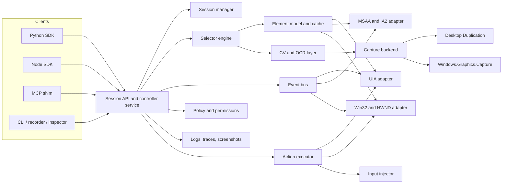
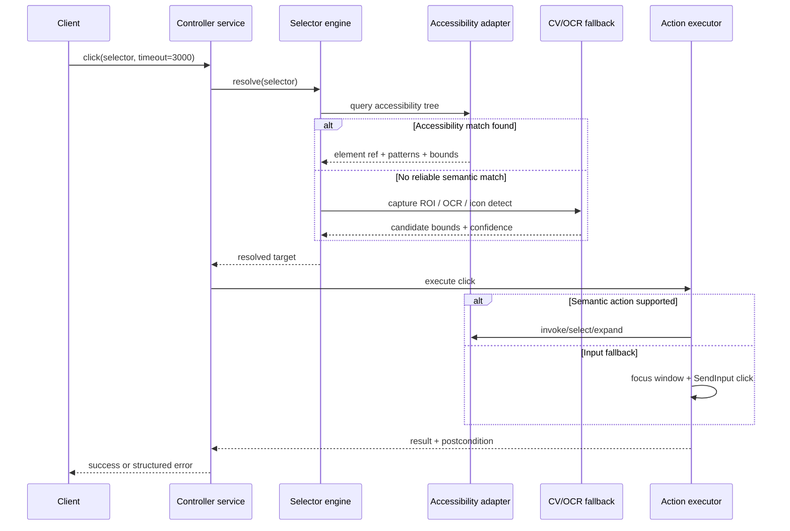

> **Superseded for implementation.** Background research only. Normative specs: [../SPEC.md](../SPEC.md), [../stack.md](../stack.md), [../tools.md](../tools.md), [../architecture.md](../architecture.md). Markdown extract of optional PDF [open-source-windows-gui-control-for-ai-agents.pdf](open-source-windows-gui-control-for-ai-agents.pdf) (not tracked in git). Body retains raw citation markers from import.

# Open-Source Windows GUI Control for AI Agents

## Executive summary

The open-source Windows GUI automation landscape is real, but it is fragmented into three distinct layers. The first layer is **accessibility-first automation**, built on Microsoft UI Automation and older accessibility stacks; this is where the most mature Windows-native tools live, including pywinauto, FlaUI, WinAppDriver, and Python UIAutomation wrappers. The second layer is **image/input-first automation**, such as PyAutoGUI, SikuliX, and RobotJS, which works even when applications expose little or no accessibility metadata, but is naturally more brittle under DPI changes, theming, localization, and layout drift. The third layer is the new **agent/MCP layer**, where projects such as Windows-MCP and MCPControl expose desktop control to LLMs through MCP or similar protocols; these are promising, but today they mostly wrap lower-level primitives rather than providing the equivalent of a Playwright-quality native Windows driver. citeturn25search10turn25search1turn14view0turn14view1

The most important technical conclusion is that a serious Windows GUI control stack should be **hybrid by design**. UI Automation gives the best selectors and the safest semantics when controls expose a good automation tree, including properties, control patterns, and events. But UIA coverage is uneven across legacy Win32 apps, custom-drawn controls, remote/virtualized surfaces, browser edge cases, icon-only toolbars, and GPU-heavy or game-like UIs. A perception fallback using OCR, layout analysis, and lightweight GUI element detection is therefore not optional if the goal is broad agent coverage. Recent agent-oriented work such as OmniParser, OSWorld, and Windows Agent Arena reinforces that modern “computer-use” systems need both a structured action interface and screen understanding. citeturn20search0turn20search1turn27view4turn35search4turn35search10turn35search5

Windows security and privilege boundaries are the main architectural constraint. UIPI prevents lower-integrity processes from sending many messages or injected input into higher-integrity targets, and Microsoft’s documented UIAccess path is narrowly scoped to trusted assistive technologies, with signing, secure installation location, and manifest requirements. In practice, that means a production-grade open-source controller should default to **non-elevated automation**, treat elevation as an explicit opt-in mode, and keep privileged helpers separate from the main daemon. citeturn27view2turn27view0turn27view1turn27view5turn21search2

The best open-source-friendly product direction is therefore a **two-layer design**: a deterministic Windows controller service modeled more like WebDriver or Playwright, and an optional MCP shim that exposes agent-friendly tools on top of it. MCP is well-suited to tool interoperability, while WebDriver remains the clearest precedent for a language-neutral remote control interface. A native Windows controller should apply the same separation of concerns to desktop automation. citeturn15search0turn15search6turn15search1

## Open-source project inventory

The table below focuses on projects directly relevant to programmatic control of Windows desktop GUIs, plus a few adjacent harness/perception projects that matter for AI-agent use. “Accessibility/UIA/MSAA/IA2” means the project directly consumes Windows accessibility APIs or clearly exposes selector semantics based on those APIs. “Image-based” means template matching, screenshot parsing, or vision-first operation. Links are in the **Sources** column.

| Project | Category | License | Primary language | Element-level control | Image-based automation | Accessibility / UIA / MSAA / IA2 | Low-level input | Remote / agent support | Maturity / last surfaced update | Sources |
|---|---|---:|---|---|---|---|---|---|---|---|
| pywinauto | Windows automation library | BSD-3-Clause | Python | Yes | No | Yes; Win32 and UIA backends | Yes; keyboard/mouse modules | Local scripting/API | Mature; package signal updated Jan 2025 | citeturn5search2turn5search6turn5search20 |
| FlaUI | Windows automation library | MIT | C# | Yes | No | Yes; wrapper over native UI Automation | Partial; usually through UIA-driven actions | Local .NET API | Mature; surfaced update Jan 2025 | citeturn5search0turn5search4 |
| WinAppDriver | Remote automation driver | MIT | C++ / C# service with multi-language clients | Yes | No | Not explicitly stated in surfaced repo text, but exposes Selenium-like Windows element automation | Limited; action layer is WebDriver-style | Yes; Selenium/Appium remote model | Mature, long-lived Microsoft project | citeturn5search1turn5search5 |
| Python UIAutomation for Windows | Windows automation library | Apache-2.0 inferred from package ecosystem; exact SPDX not re-opened in this pass | Python / C++ extension | Yes | No | Yes; Windows UI Automation by design | Partial | Local scripting/API | Mature; PyPI release Aug 2025 | citeturn36search0turn36search3turn36search12 |
| AutoHotkey | Scripting / macro automation | GPL-2.0 | C++ + AHK script | Limited semantic control | No | No | Yes; strong hotkey/input automation | Local scripting; easy to invoke from agents | Very mature; v2.0.22 released Mar 2026 | citeturn8view1turn10view0 |
| PyAutoGUI | Image/input automation | BSD-3-Clause | Python | No | Yes; basic image recognition | No | Yes | Local scripting/API | Mature; package signal Jun 2023 | citeturn8view4turn9search15turn9search12 |
| SikuliX / OculiX continuation | Vision-first desktop automation | License not verified in surfaced sources here | Java + Jython/Ruby scripting | No | Yes; OpenCV-based | No | Yes | Local scripting; useful for inaccessible surfaces | Mature concept; continuation moved to OculiX in 2026 | citeturn5search3turn5search7turn5search10 |
| RobotJS | Desktop input/screen library | MIT | Node.js / native addon | No | Partial; screen read only | No | Yes | Good building block for agents | Moderate; still described as pre-1.0, with Windows 11 issues reported | citeturn8view3turn7search1 |
| TestStack.White | Legacy Windows automation library | Mixed / unclear on repo page | C# | Yes | No | Yes; based on UI Automation | Partial | Local .NET API | Deprecated; latest surfaced release Jun 2014 | citeturn8view0 |
| Windows-MCP | MCP desktop control server | MIT | Python | Yes; via snapshot/state tools | Yes; screenshot-first and optional vision | Yes; UI state, browser DOM mode, Firefox IA2 fallback | Yes | Yes; stdio/SSE/HTTP, auth/TLS options | Early but active; feature-rich 2026 project | citeturn14view0 |
| MCPControl | MCP desktop control server | MIT | TypeScript / Node.js | Limited; focus is operations over mouse, keyboard, windows | Partial; screen capture/analysis | Not clearly exposed in surfaced docs | Yes | Yes; SSE/local/VM scenarios | Early but active; 333 commits surfaced | citeturn14view1 |
| MCP Windows Desktop Automation | MCP wrapper over AutoIt | MIT | TypeScript | Yes; via AutoIt control functions | Partial; screenshots | No | Yes | Yes; stdio + WebSocket | Very early; 4 commits, no releases | citeturn14view2 |
| Windows Agent Arena | AI harness / benchmark | License not verified in surfaced sources here | Python | N/A as a library; benchmark environment | Multimodal agent setting | N/A | N/A | Yes; built for Windows desktop agents | Important 2024+ Windows evaluation harness | citeturn35search1turn35search5turn35search9 |
| OSWorld | AI harness / benchmark | License not verified in surfaced sources here | Python | N/A as a library; benchmark environment | Multimodal agent setting | N/A | N/A | Yes; real-computer, cross-OS benchmark including Windows | Important 2024+ benchmark; verified infrastructure update in 2025 | citeturn35search2turn35search10turn35search6 |
| OmniParser | Perception module for GUI agents | CC-BY-4.0 | Python | Detects GUI elements, but does not control them | Yes; pure vision screen parsing | No; vision-first | No | Yes; intended for LLM/agent integration | Important 2024 screen parser | citeturn35search0turn35search4turn35search8 |

What the table shows is that **maturity still clusters around accessibility-first libraries**, not around MCP-native or AI-native systems. pywinauto, FlaUI, WinAppDriver, and older White-style stacks exist because UI Automation still offers the most reliable semantic grounding on Windows when providers are implemented well. By contrast, the MCP projects are younger and mostly concentrate on tool exposure, orchestration, and screenshot/state packaging rather than on a deep native element model. citeturn5search2turn5search0turn5search1turn14view0turn14view1turn14view2

The adjacent harness/perception projects matter because they show where the field is going. Windows Agent Arena and OSWorld provide evaluation infrastructure for multimodal desktop agents, while OmniParser directly targets screenshot-to-element grounding. Together they imply that a future-proof Windows controller should not stop at UIA wrappers; it should produce structured state, screenshots, and fallback perception hooks suitable for agent loops and benchmarking. citeturn35search5turn35search10turn35search4

## Windows control interfaces

Windows exposes several overlapping control surfaces. The safest way to think about them is as a stack: **semantic accessibility APIs** at the top, **HWND/window/message APIs** in the middle, and **input/capture/driver APIs** at the bottom. A strong automation tool uses the highest layer available for the task, and only falls downward when required. citeturn25search10turn25search1turn20search0turn27view2

| API / mechanism | Capabilities | Limitations | Permission / privilege notes | Typical use cases | Sources |
|---|---|---|---|---|---|
| UI Automation | Discover elements as a tree; query properties; invoke control patterns; subscribe to events | Coverage depends on provider quality; custom-drawn or poorly instrumented controls may be weak; threading must be handled carefully | User-level works for same-IL apps; elevated/protected UI requires UIAccess/admin conditions | Primary selector system for Win32, WinForms, WPF, UWP/Store-style apps where providers exist | citeturn20search0turn20search1turn20search3turn27view5 |
| IUIAutomation COM interfaces | Direct COM access to root element, conditions, element queries, events, tree walking | Lower-level and more verbose than wrappers; COM/threading complexity | Same boundary considerations as UIA generally | Native service implementation, high-performance querying, event subscriptions | citeturn20search0turn20search15turn20search17 |
| MSAA / IAccessible | Legacy accessible object model with common attributes and behaviors | Smaller fixed property/action surface than UIA; weaker semantic/action model | Works broadly on older apps; still subject to Windows security boundaries | Legacy app coverage, compatibility fallback, inspection | citeturn16search13turn25search7turn25search4 |
| IAccessible2 | Extends MSAA with richer information for accessible objects | Not the native “one standard” Windows layer; depends on app/browser support | App-specific support; useful where IA2 is implemented | Firefox and some rich document/browser tooling; bridging gaps left by UIA | citeturn16search3turn16search9turn14view0 |
| IAccessibleEx | Bridge from MSAA objects into UIA properties/patterns without a full provider rewrite | Transitional rather than complete; only as good as provider implementation | Same accessibility trust boundary rules apply | Upgrading legacy controls, bridging mixed accessibility stacks | citeturn25search2turn25search8turn25search13 |
| SetWinEventHook | Subscribe to accessibility/window events across processes; scope by process/thread; in- or out-of-context delivery | Requires a message loop; out-of-context delivery is queued; bitness and console-process cases affect delivery behavior | Cross-process eventing on the current desktop; not a general write/control API | Event-driven waits, focus/window-change notifications, stale-element detection | citeturn27view4turn26search0 |

| API / mechanism | Capabilities | Limitations | Permission / privilege notes | Typical use cases | Sources |
|---|---|---|---|---|---|
| HWND / Win32 window functions | Enumerate windows, move/resize/reorder windows, manage z-order and visibility | Window-level only; little semantic control of internal widgets | Same desktop/session assumptions; some focus rules still apply | Window discovery, attach-by-title/class, geometry management | citeturn17search1turn17search9turn17search17 |
| SendMessage | Synchronous delivery to a window procedure; useful for app-specific commands and some control interactions | App/message specific; caller blocks until processed; not a generic input replacement | Subject to UIPI; only same or lower integrity targets | Safe, explicit control when you know the message contract | citeturn27view0 |
| PostMessage | Asynchronous posting to a thread message queue | Async only; pointers forbidden for async functions below `WM_USER`; custom marshalling needed for messages `>= WM_USER`; queue limits exist | Subject to UIPI; access-denied on blocked posts | Low-coupling notifications, app-specific async messaging | citeturn27view1 |
| SendInput | Inject keyboard/mouse events serially into the input stream | Focus-sensitive; not target-specific on its own; does not reset keyboard state; blocked by UIPI with poor diagnostics | Can inject only into equal or lower integrity targets | Universal fallback for click/type/drag/hotkeys | citeturn27view2 |
| Raw Input | Receive low-level HID input data and device-specific events | Monitoring only, not injection; app must register devices to receive `WM_INPUT` | Standard user mode for registered devices | Input monitoring, advanced key/mouse observation, telemetry | citeturn19search3turn19search1turn19search20 |
| SetWindowsHookEx | Install thread/global hooks; can inject DLLs into target processes depending on hook type | Bitness-sensitive; fragile; requires message pumping; risky for broad automation exposure | Cross-process hooks depend on process architecture and normal security boundaries | Monitoring, special integrations, niche interception—not a first choice for standard automation | citeturn27view3turn18search10 |
| DWM thumbnails | Live thumbnail relationship between source and destination windows | Visual only, not controllable semantics | Standard desktop API use | Visual previews, operator UIs, verification dashboards | citeturn19search2turn19search8 |
| Desktop Duplication | Fast frame-by-frame desktop capture via DXGI surface, GPU-friendly | Capture only; whole-output oriented; no inherent semantics | Standard desktop capture path | Real-time screen capture for OCR/CV or remote collaboration | citeturn28search0turn28search6 |
| Windows.Graphics.Capture | Secure capture of windows/displays, with system-backed capture APIs | Modern Windows-only path; Win32 interop availability depends on Windows 10 version | Requires supported Windows 10+ environment | Per-window capture, snapshots, modern capture backend | citeturn28search3turn28search1turn28search5 |
| Virtual HID Framework / HID minidrivers | Present synthetic HID devices to Windows through driver infrastructure | Far higher complexity and operational risk than user-mode APIs; capture/control semantics move into driver space | Driver-development/deployment path; unsuitable as the starting point for a general OSS controller | Specialized research/test rigs, highly constrained anti-cheat or device emulation scenarios | citeturn24search2turn24search8 |

Two security facts dominate the entire stack. First, **UIPI** blocks lower-integrity processes from sending many messages and injected input to higher-integrity targets; this shows up explicitly in `SendMessage`, `PostMessage`, and `SendInput`. Second, Microsoft’s **UIAccess** path is deliberately narrow: a UIAccess app must be signed, installed in a secure location such as Program Files, and carry the correct manifest flag; even then, it is not a magic bypass for SYSTEM-level UI. This is why a production controller should never assume “desktop control” implies “full desktop control.” citeturn27view0turn27view1turn27view2turn27view5turn22search2

From an engineering perspective, the decision tree is straightforward. Use **UIA patterns first** for button invocation, value setting, selection, toggles, and expansion. Use **Win32 window APIs** for host-window lifecycle and geometry. Use **message APIs** only when the target application’s message contract is known and stable. Use **SendInput** as the general fallback when semantic control is unavailable. Use **capture APIs plus OCR/CV** when neither accessibility nor messaging is sufficient. Driver-level injection should remain explicitly out of scope until the far end of the roadmap. citeturn20search1turn17search1turn27view0turn27view2turn28search0turn24search2

## Screen understanding models and toolkits

For real-time Windows screen understanding, the right question is not “which single OCR engine is best?” but rather “which **mix** of text recognition, layout parsing, and GUI-object grounding** minimizes latency for the current step?” In practice, a desktop controller should prefer **ROI-first perception**: first use accessibility or window metadata to narrow candidates, then run OCR or icon detection only on those regions, and reserve full-screen parsing for inaccessible apps or ambiguous states. That is how modern agent work such as OmniParser becomes practical rather than prohibitively expensive. citeturn20search3turn35search4turn35search8

| Toolkit / model family | Best fit | Strengths | Trade-offs | Integration notes for a Windows GUI tool | Sources |
|---|---|---|---|---|---|
| Tesseract 5 | Low-dependency printed OCR on cropped regions | Mature, offline, Apache-2.0, broad language support, LSTM engine and official traineddata sets | Less convenient than modern deep OCR stacks for difficult scene/UI text; not a layout engine by itself | Good baseline fallback for ROI OCR, offline deployments, and environments where deep dependencies are undesirable | citeturn29search4turn29search8turn29search16turn29search19 |
| EasyOCR | Quick Python OCR for screenshots and scene text | Very easy setup; supports 80+ languages; works on scene text and dense text | Less structured than full document pipelines; heavier than classic OCR for minimal installs | Good for rapid prototyping and multilingual fallback OCR in Python-centric stacks | citeturn29search2turn29search6turn29search10 |
| PaddleOCR / PP-OCRv5 | Best default open-source OCR pipeline for product use | Strong multilingual support; explicit mobile/server model split; repo emphasizes structured JSON/Markdown output and document parsing | Broader dependency footprint than Tesseract; full stack can be more than needed for tiny ROI tasks | Best overall default for OCR service layer; use mobile models for ROI OCR and server models only when accuracy needs justify them | citeturn34search5turn34search3turn34search10turn34search16turn34search18 |
| docTR | Python-first OCR with reading-order/document export focus | Good ergonomic API and end-to-end OCR pipeline; actively maintained | More document-oriented than GUI-specific; not purpose-built for icon grounding | Strong choice when screenshots include document-like panes, PDFs, or complex text blocks | citeturn29search3turn29search7turn29search22 |
| LayoutParser | Layout region detection / document structure | Clean API for deep layout parsing; pairs well with OCR | Not an OCR engine by itself; best for structural segmentation | Useful when UI surfaces resemble forms, reports, PDFs, or dense dashboards | citeturn30search4turn30search16turn30search19 |
| MMOCR | Custom OCR research/deployment toolbox | Rich model zoo for text detection, recognition, and downstream tasks; OpenMMLab infra | Heavier engineering/setup cost than turnkey OCR libraries | Best when you need to train or swap detectors/recognizers rather than just consume OCR | citeturn31search0turn31search1turn31search5turn31search13 |
| CRAFT | Text detection for arbitrarily shaped scene text | Strong detector for irregular/curved text; widely used in practical OCR stacks | Detector only; must be paired with a recognizer | Good region proposal model when UI text is stylized or laid out irregularly | citeturn33search0turn33search3 |
| DBNet / DBNet++ | Lightweight real-time text detection | Strong speed/accuracy trade-off; paper reports 62 FPS with a ResNet-18 backbone on MSRA-TD500 | Detector only; needs recognition stage | Good custom detector if you need a fast CPU/GPU text-proposal stage for screen OCR | citeturn32search2turn32search8turn32search5 |
| CRNN | Compact recognizer for custom OCR stacks | Still one of the simplest effective recognizers for image-based sequence recognition | Older architecture than transformer recognizers | Excellent lightweight recognizer paired with DBNet/CRAFT in a custom screen-text OCR pipeline | citeturn32search0 |
| TrOCR | Higher-accuracy transformer recognizer | Strong end-to-end transformer OCR; Microsoft-origin checkpoints are well supported in Transformers | Heavier than CRNN-style recognizers; less suitable for very tight latency budgets | Use when OCR quality matters more than minimal CPU/GPU load, especially on difficult cropped text | citeturn32search3turn32search6turn32search15 |
| OmniParser | GUI element/icon detection and grounding | Specifically designed for UI screenshot parsing into structured elements; directly relevant to LLM action grounding | Not a deterministic control API; vision-only parsing is still probabilistic | Ideal as a fallback CV layer for icon-only controls, inaccessible apps, or screenshot-only agent modes | citeturn35search4turn35search8turn35search0 |

A practical recommendation for the proposed tool is a **three-tier perception stack**. Tier one should be **no OCR at all** when UIA/MSAA/IA2 already provide element text and structure. Tier two should be **fast ROI OCR**, with PaddleOCR mobile models as the mainline option and Tesseract as the lowest-dependency fallback. Tier three should be **full screenshot parsing**, using OmniParser or a custom detector when the app is inaccessible or the relevant affordance is icon-only. LayoutParser and docTR are best treated as optional structure-aware modules for document-like panes rather than as the default path for every click. citeturn20search11turn25search1turn34search5turn29search4turn35search4turn30search4turn29search7

The main performance lesson from the open-source OCR literature is that **detector and recognizer can be decoupled**. A lightweight detector such as DBNet with a compact recognizer such as CRNN is still a very credible low-latency stack. Transformer recognizers such as TrOCR can raise accuracy but should be used selectively on hard crops or post-failure retries rather than on every frame. That design keeps average-step latency low while still improving recovery on difficult screens. citeturn32search2turn32search0turn32search3

## Primary references and recent literature

The most useful primary sources divide into four buckets: Microsoft platform documentation, protocol/interface specifications, project docs for practical open-source libraries, and recent research on multimodal desktop agents. The list below emphasizes sources from the last five years when possible, while retaining a few earlier foundational OCR papers that are still directly relevant to lightweight implementation choices.

| Source family | Why it matters | Sources |
|---|---|---|
| Microsoft accessibility and automation docs | Authoritative reference for UIA, MSAA, IAccessibleEx, control patterns, properties, eventing, and security boundaries | citeturn25search10turn25search1turn20search0turn20search1turn25search2turn27view5 |
| Microsoft input/windowing docs | Ground truth for SendInput, message APIs, hooks, window management, Raw Input, and DWM | citeturn27view2turn27view0turn27view1turn17search1turn19search3turn27view3turn19search8 |
| Microsoft capture docs | Best source for capture backend selection on Windows 10+ | citeturn28search0turn28search3turn28search1turn28search5 |
| MCP and WebDriver specifications | Best models for agent interoperability and language-neutral remote control semantics | citeturn15search0turn15search6turn15search1 |
| Recent agent papers | Show the present-day benchmark and architecture direction for real-computer agents | citeturn35search5turn35search10turn35search17turn35search18 |
| OmniParser | Most relevant recent screen-grounding paper/project for screenshot-first GUI agents | citeturn35search4turn35search8turn35search0 |
| OCR/layout toolkits | Practical open-source building blocks for production perception stacks | citeturn34search5turn29search7turn30search4turn31search0 |
| OCR foundation papers | Still the key references for lightweight detection/recognition trade-offs | citeturn32search0turn33search0turn32search2turn32search3 |

Three recent research threads are especially relevant to an MCP-like Windows GUI controller. **OSWorld** argues that real-computer benchmarking is necessary because standard web-only or narrow task benchmarks do not capture genuine computer-use complexity. **Windows Agent Arena** narrows that lens to the Windows ecosystem and underlines the need for realistic Windows application coverage. **OmniParser** shows that pure visual grounding materially improves screenshot-based action prediction, especially when semantic accessibility data is missing or incomplete. Together these sources strongly support a controller that exposes structured elements when possible, but always retains a screenshot/perception fallback. citeturn35search10turn35search5turn35search4

Project documentation reinforces the same conclusion from the implementation side. Microsoft’s UI Automation docs make clear that the platform already offers an object model, properties, control patterns, and events; open-source libraries such as pywinauto and FlaUI mainly become successful by making those APIs pleasant to use. The newer agent/MCP projects become useful when they package the same primitives into tool-oriented transports and add screenshot/state handling, not when they replace the underlying semantics. citeturn20search0turn20search1turn5search2turn5search0turn14view0turn14view1

## Reference architecture and implementation roadmap

The right architectural goal is **not** “an MCP server that clicks on things.” It is a **deterministic Windows controller service** with a stable element model, a selector engine, robust waiting/error semantics, and a narrow privileged surface. MCP should sit on top as one transport and orchestration layer, not as the only interface. That parallels how WebDriver separates the browser automation engine from the client bindings, while MCP defines how LLM applications discover and call external tools. citeturn15search1turn15search0turn15search6



The controller service should be local to the target Windows desktop and expose a language-neutral API over **JSON-RPC or HTTP/WebSocket**, with generated SDKs for Python and Node. The core implementation language should be **C#/.NET** unless there is a strong need for lower-level native code: Windows accessibility and COM interop are mature there, Win32 bindings are solid, and producing an OSS Windows-first service is faster than starting in Rust or C++. A small native helper can still be added later for edge capture or input cases, but it should not be the architectural center.

The **core components** should be these:

| Component | Responsibility | Recommended approach |
|---|---|---|
| Session manager | Attach to apps/windows, manage lifecycle, isolate clients | One process-local controller service, multiple sessions by window/process |
| Element model | Stable IDs, bounds, ancestry, source backend, supported actions | Cache UIA/MSAA/IA2/Win32 facts plus confidence and staleness metadata |
| Accessibility adapter | Primary query path and action semantics | UIA first; MSAA/IAccessible2 bridge where UIA is weak |
| Win32 adapter | Window enumeration, focus, resize, z-order, app/process attach | Wrap HWND APIs and selected message-based operations |
| Capture layer | Window/display frames for OCR and debugging | Prefer Windows.Graphics.Capture when available; DXGI Desktop Duplication fallback on Windows 10+ citeturn28search3turn28search0 |
| CV/OCR layer | OCR, icon grounding, layout parsing | PaddleOCR mobile + Tesseract fallback; OmniParser optional GUI grounding layer citeturn34search5turn29search4turn35search4 |
| Input injector | Click, type, drag, hotkeys | Prefer UIA patterns; fall back to SendInput; use messages only for known contracts citeturn20search1turn27view2turn27view0 |
| Event bus | Window and element change notifications | SetWinEventHook + UIA events where available citeturn27view4turn20search9 |
| Security / policy | Capability allowlists, redaction, elevation control | Default non-elevated, separate helper for privileged scenarios, full audit trail |
| Logging / telemetry | Reproducibility and failure analysis | Structured action logs, selector traces, screenshots, timings, element snapshots |

The **selector strategy** should be hybrid and explicit. The selector language should support accessibility-first queries such as `role=Button[name="OK"]`, `automationId=saveBtn`, and `path=/Window/Edit[1]`, plus spatial/contextual selectors such as `below(text("Username"))`, and finally vision selectors such as `ocr:"Save As"` or `icon:"trash"`. Resolution order should be:

1. **Accessibility-first** using UIA properties and control patterns.
2. **Legacy bridge** using MSAA/IAccessible2 when UIA is incomplete.
3. **Win32 context refinement** using host window, class name, or HWND ancestry.
4. **Vision fallback** using OCR/icon detection on the active window or a narrowed ROI.
5. **Coordinate-only fallback** only when all semantic strategies fail.

That order is justified by Microsoft’s richer UIA property/pattern model and by the fact that screenshot-only approaches are inherently probabilistic. citeturn25search1turn20search11turn35search4

A minimal but credible **API surface** would include the following methods:

| Method / endpoint | Behavior | Notes |
|---|---|---|
| `createSession()` | Start or attach a controller session | Supports attach by pid, title, class, executable |
| `listWindows()` | Enumerate top-level windows with metadata | Uses Win32 window APIs |
| `snapshot()` | Return current structured state | Tree + visible windows + optional screenshot |
| `query(selector)` | Resolve one or more elements | Returns stable element refs and confidence |
| `getElement(ref)` | Read current properties/patterns/bounds | Revalidates staleness |
| `click(ref or selector)` | Perform click or invoke | Prefers semantic pattern actions before pointer injection |
| `type(ref, text)` | Set or enter text | Prefer ValuePattern/set semantics, else focus + SendInput |
| `press(keys)` | Global or window-scoped shortcuts | Uses SendInput/hotkey sequencing |
| `setWindowState()` | Focus, move, resize, minimize, restore | Win32 + SetWindowPos layer |
| `scroll()` / `drag()` | Pointer-driven interactions | Input injector with optional semantic scroll pattern |
| `screenshot()` | Window/display/element capture | Capture backend abstraction |
| `waitFor()` | Wait for selector/event/state | Event-driven when possible, polling fallback |
| `subscribeEvents()` | Async stream of focus/window/tree changes | WebSocket or server-sent stream |
| `getLogs()` / `getTrace()` | Read structured action traces | First-class debugging support |

The service should expose **sync and async** behavior clearly. All action methods should be synchronous by default from the caller’s perspective, returning only after the action has been dispatched and optional wait conditions have been satisfied or timed out. Event streams should be asynchronous over WebSocket. That yields a programming model closer to Playwright than to ad hoc scripting.

A representative **sequence flow** should look like this:



The **error model** should be structured, not textual. At minimum, define stable error codes such as `ElementNotFound`, `AmbiguousMatch`, `StaleElement`, `ActionNotSupported`, `FocusDenied`, `PrivilegeBoundary`, `WindowClosed`, `VisibilityMismatch`, `LowConfidenceVisionMatch`, and `TimeoutExceeded`. Each error should include the original selector, the backend attempted, candidate matches, screenshot/trace IDs, and recovery hints. This is especially important for LLM agents, which need machine-readable failure reasons.

A good initial **performance budget** is best expressed as proposed targets, not as guarantees:

| Metric | Proposed target |
|---|---|
| Window enumeration | p95 under 30 ms on a local desktop |
| Accessibility query for a modest tree | p95 under 100 ms |
| Screenshot of a single window | p95 under 40 ms |
| ROI OCR on a small crop | p95 under 120 ms with lightweight models |
| End-to-end click dispatch | p95 under 250 ms excluding app response |
| Full `snapshot()` with tree and screenshot | p95 under 200 ms on ordinary business apps |

The **security model** should be conservative. The daemon should run non-elevated by default, expose only explicit capabilities, and require per-session approval or policy to access file system, PowerShell, clipboard, or remote transports. If privileged automation is needed, ship a **separate helper** rather than running the whole service elevated. Any future UIAccess mode should follow Microsoft’s documented requirements—signed binary, secure install location, manifest flag—and should be framed as an accessibility-compatible advanced feature, not a default operating mode. citeturn27view5turn22search2turn22search0

A small **integration example** for Python could look like this:

```python
from wingui import WindowsController

ctl = WindowsController.connect()
session = ctl.attach(window_title="Untitled - Notepad")

editor = session.query('role=Edit')
editor.type_text("hello from Python")

session.query('role=MenuItem[name="File"]').click()
session.query('hybrid(role=MenuItem,name="Save As")').click()
```

And for Node:

```ts
import { connect } from "@wingui/client";

const ctl = await connect();
const session = await ctl.attach({ title: /Notepad/ });

await session.query('role=Edit').typeText("hello from Node");
await session.query('role=Button[name="OK"]').click();
```

For an **MCP shim**, the top-level tools should be coarse enough for agent planning but still deterministic: `snapshot`, `query`, `click`, `type`, `press`, `wait_for`, `move_window`, `screenshot`, and `read_logs`. Do not expose raw unrestricted desktop actions without a policy layer. The MCP server should be a broker over the controller service, not the only implementation surface.

The **prioritized roadmap** should be:

| Priority | Milestone | Deliverables | Why this order |
|---|---|---|---|
| Highest | Accessibility-first local controller | Session manager, UIA queries, Win32 window attach, click/type/wait, Python SDK | Delivers the most reliability with the least ambiguity |
| High | Traceability and robustness | Inspector UI, structured logs, event hooks, stale-element recovery, Node SDK | Makes the tool debuggable and usable in CI/agent loops |
| High | Capture and perception fallback | DXGI/WGC capture, ROI OCR, hybrid selectors, screenshot traces | Expands support to inaccessible or partially accessible apps |
| Medium | MCP shim and remote mode | MCP wrapper, WebSocket/SSE transport, auth, session-scoped policies | Enables agent ecosystems without destabilizing the core |
| Medium | Legacy/browser fallbacks | MSAA/IA2 bridge, browser-specific adapters where needed | Covers Firefox/web/document edge cases that UIA alone misses |
| Lower | Recorder and benchmark integration | Recorder/replayer, replay diffing, Windows Agent Arena / OSWorld adapters | Useful once the core semantics are stable |
| Lowest | Driver-level experimentation | Optional research path with virtual HID or custom drivers | High operational cost and security risk; defer until justified |

The **risk analysis** is manageable but real:

| Risk | Why it matters | Mitigation |
|---|---|---|
| Incomplete UIA coverage | Custom controls and legacy apps may expose weak trees | Keep MSAA/IA2 bridge and vision fallback |
| UIPI / elevation boundaries | Actions may silently fail against elevated windows | Make privilege state explicit; separate helper; structured `PrivilegeBoundary` errors |
| Focus and race conditions | The wrong window may receive `SendInput` | Re-check foreground window before input; prefer semantic patterns |
| DPI, scaling, theming, localization | Vision selectors and coordinates drift easily | Normalize coordinate spaces; use semantic selectors first; keep OCR/icon fallback language-aware |
| Browser edge cases | Firefox and some embedded content expose different accessibility paths | Maintain IA2 fallback and per-app adapters where necessary |
| Security exposure | A remote desktop controller can become an abuse surface | Capability allowlists, auth, sandboxed remote transport, full audit logging |
| Maintenance sprawl | Supporting every niche API raises complexity quickly | Keep the core narrow and plugin-based; defer exotic paths |
| Driver-level ambitions | Kernel- or driver-level work sharply raises install and maintenance burden | Keep out of MVP and major releases unless a concrete user need appears |

Open questions and limitations remain. I did not fully verify the exact SPDX license or latest commit date for every niche project surfaced in the ecosystem, especially some RPA platforms and continuation/fork projects; where that was not high-confidence, I marked it explicitly rather than guessing. Performance numbers for OCR and desktop capture vary heavily by hardware, DPI, app framework, and whether capture is whole-screen or window-scoped. And some wrapper libraries do not clearly document their exact underlying API in the top-level project page, even when their behavior strongly implies UIA-backed operation.
